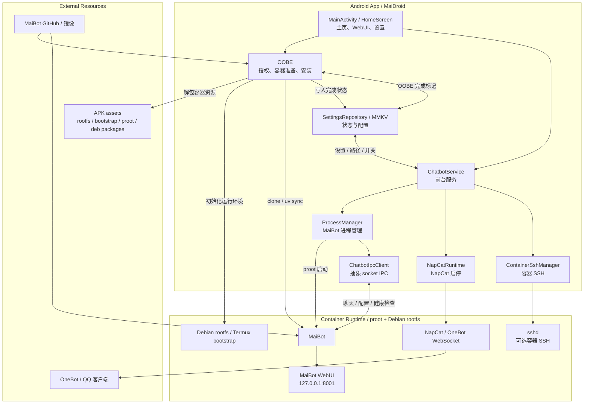

# MaiDroid

~~饺子醋x~~

~~本质是为了完善MaiWeb官网而做的安卓APP~~

你说得对，但是 MaiDroid 是一个面向 Android 设备的 MaiBot 运行方案，目标是在移动端完成容器环境准备、MaiBot 部署以及基础运行管理。

当前仓库已经包含以下主要模块：

- OOBE 配置页和安装流程
- 容器资源解包
- 前台服务
- 开机自启控制
- MaiBot 容器配置
- WebUI 页面
- 基础 IPC 客户端

## 当前能力

- 展示 OOBE，引导授权、准备容器并安装 MaiBot
- 解包内置的 Debian rootfs、bootstrap 和 proot 相关资源
- 启动前台服务，保持后台运行
- 打开 MaiBot WebUI
- 记录运行日志，便于排查问题
- 根据设置控制开机自动启动

## 仍待完善

- Android 与 MaiBot 的最终通信协议仍在收敛
- 稳定的消息闭环、健康检查和错误提示还需要补齐
- 无障碍、输入法、通知监听等能力尚未全部落地

## 架构图



这张图主要表达三层关系：

- Android 负责引导、配置、启动和管理
- 容器里跑 Debian / MaiBot / NapCat / sshd
- 外部资源来自 APK assets 和 GitHub 镜像，最终由 OOBE 拉起来

## 项目结构

- `app/src/main/java/org/maiwithu/maidroid/oobe/`：OOBE 安装流程
- `app/src/main/java/org/maiwithu/maidroid/container/`：容器资源、路径和安装脚本
- `app/src/main/java/org/maiwithu/maidroid/process/`：MaiBot 进程管理
- `app/src/main/java/org/maiwithu/maidroid/service/`：前台服务
- `app/src/main/java/org/maiwithu/maidroid/ui/`：主界面、OOBE 和 WebUI 页面
- `app/src/main/java/org/maiwithu/maidroid/ipc/`：Android 侧 IPC 客户端

## 本地构建

在 Windows PowerShell 中可以使用：

```powershell
.\gradlew.bat assembleDebug
```

构建产物通常位于 `app/build/outputs/`。

## 发布与签名

日常开发在 `dev` 分支，`main` 只接收从 `dev` 合入的内容。推送到 `main` 会触发发布流程（`.github/workflows/release.yml`）。日常调试用 `assembleDebug`，调试密钥由每台机器自动生成，不同机器构建出的 APK 签名不同，互相覆盖安装前需要先卸载。

### 发布一个新版本

1. 在 `dev` 上把本次更新的说明写进 `CHANGELOG.md` 最上面的 `## [Unreleased]` 一节。
2. 在 `dev` 上执行 `.\gradlew.bat bumpVersion -Pbump=<major|minor|patch>`，指定 a.b.c 里要 +1 的那一位：
   - `patch` 只加最后一位，例如 0.1.0 -> 0.1.1；
   - `minor` 加中间一位并把最后一位清零，例如 0.1.3 -> 0.2.0；
   - `major` 加第一位并把后两位都清零，例如 0.4.2 -> 1.0.0；
   - `versionCode` 固定 +1。

   任务会同步改写 `app/build.gradle.kts` 和 `CHANGELOG.md`（`Unreleased` 变成带版本号和日期的新一节，并在最上面补一个空的 `Unreleased`）。`Unreleased` 没有内容时任务会报错。
3. 提交，合入 `main` 并推送。
4. 流程读取 `CHANGELOG.md` 最上面带版本号的一节：对应的标签 `v<版本号>` 不存在时，构建、签名并创建 Release，说明就是这一节的正文，标签由流程创建；标签已存在则跳过，所以没有新增版本的推送不会重复发布。

版本号带连字符（例如 `0.2.0-rc1`）会按预发布处理，需要手工写进 `CHANGELOG.md` 和 `versionName`，`bumpVersion` 只处理 a.b.c 纯数字。在 Actions 页面手动运行该工作流只会产出试跑用的 APK，不创建 Release（需要本文件已经在 `main` 上）。

### 发布密钥

发布密钥库不入库。流程需要在仓库的 Actions Secrets 里配置 `MAIDROID_KEYSTORE_BASE64`、`MAIDROID_KEYSTORE_PASSWORD`、`MAIDROID_KEY_ALIAS`、`MAIDROID_KEY_PASSWORD`，建议再配置变量 `MAIDROID_CERT_SHA256`（期望的证书 SHA-256），证书不一致时流程会中止。首次配置可以这样做，密码由 `keytool` 和 `gh` 交互输入，不会出现在命令行里：

```bash
keytool -genkeypair -v -keystore maidroid-release.jks -alias maidroid \
  -keyalg RSA -keysize 4096 -validity 10000 -dname "CN=MaiDroid, O=Mai-with-u"
base64 -w0 maidroid-release.jks | gh secret set MAIDROID_KEYSTORE_BASE64 --repo Mai-with-u/MaiDroid
gh secret set MAIDROID_KEYSTORE_PASSWORD --repo Mai-with-u/MaiDroid
gh secret set MAIDROID_KEY_PASSWORD --repo Mai-with-u/MaiDroid
gh secret set MAIDROID_KEY_ALIAS --repo Mai-with-u/MaiDroid --body maidroid
keytool -list -v -keystore maidroid-release.jks
gh variable set MAIDROID_CERT_SHA256 --repo Mai-with-u/MaiDroid --body "<上一步输出的 SHA-256 指纹>"
```

PKCS12 密钥库的密钥密码必须与库密码相同，`MAIDROID_KEY_PASSWORD` 填同一个值。在本地用发布密钥签名时，设置同名环境变量（另有 `MAIDROID_KEYSTORE_PATH` 指向密钥库文件）后执行 `assembleRelease`；缺少环境变量时 release 保持未签名。

发布密钥丢失后，已安装的用户无法覆盖升级，密钥库和密码请至少保留两份离线备份。

