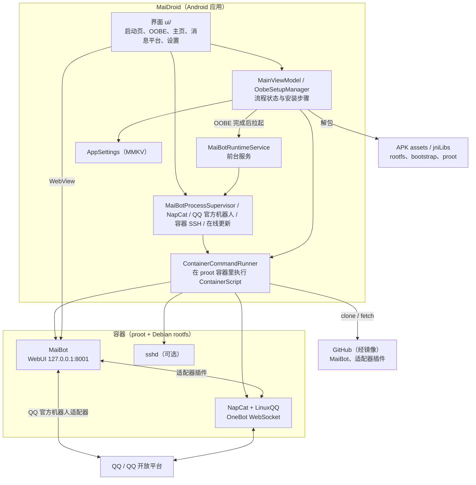

# MaiDroid

~~饺子醋x~~

~~本质是为了完善MaiWeb官网而做的安卓APP~~

你说得对，但是 MaiDroid 是一个面向 Android 设备的 MaiBot 运行方案，目标是在移动端完成容器环境准备、MaiBot 部署以及基础运行管理。

当前仓库已经包含以下主要模块：

- 首次启动引导（OOBE）：授权、配置容器、安装 MaiBot
- 容器运行时：解包内置的 Debian rootfs 与 proot，在容器里执行安装和运行脚本
- 前台服务：托管 MaiBot、NapCat 和可选的容器 SSH，开机自启
- 主页：嵌入 MaiBot WebUI、消息平台（QQ 官方机器人、NapCat）、设置（权限、在线更新、容器 SSH）
- 终端输出：集中查看容器里所有进程的日志

## 当前能力

- 展示 OOBE，引导授权、准备容器并安装 MaiBot
- 解包内置的 Debian rootfs、bootstrap 和 proot 相关资源
- 启动前台服务，保持后台运行
- 打开 MaiBot WebUI
- 记录运行日志，便于排查问题
- 根据设置控制开机自动启动

## 仍待完善

- Android 与 MaiBot 的最终通信协议仍在收敛
- 稳定的消息闭环、健康检查和错误提示还需要补齐
- 无障碍、输入法、通知监听等能力尚未全部落地

## 架构图



- Android 侧负责引导、配置、启动和管理，所有容器命令都经 `ContainerCommandRunner` 执行
- 容器里跑 Debian、MaiBot、NapCat、sshd
- 容器资源随 APK 分发，MaiBot 源码和适配器经 GitHub 镜像下载

## 项目结构

代码在 `app/src/main/java/org/maiwithu/maidroid/` 下，按功能分包：

| 包 | 内容 |
| --- | --- |
| （根） | `MaiDroidApplication`、`AppDependencies`（依赖创建处）、`MainActivity`、`MainViewModel`、`WebUiActivity` |
| `runtime/` | 容器运行时：路径、就绪检查、proot 命令、脚本执行、资源解包、GitHub 镜像 |
| `maibot/` | MaiBot 的安装与启动脚本、进程监管、在线更新（`maibot/update/`） |
| `oobe/` | 首次引导“配置容器”“安装 MaiBot”两步 |
| `service/` | 前台服务、开机广播 |
| `platform/napcat/`、`platform/qqofficial/` | QQ 的两种接入方式 |
| `ssh/` | 容器 SSH |
| `webui/` | 嵌入 MaiBot WebUI：令牌、WebView、请求改写、注入脚本 |
| `permission/`、`settings/`、`log/` | 系统权限、持久化设置、终端输出 |
| `ui/` | 界面，按页面分为 `oobe`、`home`、`platforms`、`settings`、`terminal`、`splash`，公共组件在 `component`，配色字体在 `theme` |

开发文档：

- [架构总览](docs/architecture.md)：分层、各包职责、启动流程、前台服务与长驻进程
- [容器运行时](docs/container-runtime.md)：文件布局、proot 命令、OOBE 每一步、MaiBot 启动与在线更新、容器 SSH
- [消息平台接入](docs/platforms.md)：QQ 官方机器人、NapCat，以及新增平台的步骤
- [开发指南](docs/development.md)：构建、测试、真机调试、代码约定

## 本地构建

在 Windows PowerShell 中可以使用：

```powershell
.\gradlew.bat assembleDebug
```

运行单元测试：

```powershell
.\gradlew.bat testDebugUnitTest
```

构建产物通常位于 `app/build/outputs/`。环境要求、Git Bash 下的注意事项和真机调试方法见[开发指南](docs/development.md)。

## 发布与签名

日常开发在 `dev` 分支，`main` 只接收从 `dev` 合入的内容。推送到 `main` 会触发发布流程（`.github/workflows/release.yml`）。日常调试用 `assembleDebug`，调试密钥由每台机器自动生成，不同机器构建出的 APK 签名不同，互相覆盖安装前需要先卸载。

### 发布一个新版本

1. 在 `dev` 上把本次更新的说明写进 `CHANGELOG.md` 最上面的 `## [Unreleased]` 一节。
2. 在 `dev` 上执行 `.\gradlew.bat bumpVersion -Pbump=<major|minor|patch>`，指定 a.b.c 里要 +1 的那一位：
   - `patch` 只加最后一位，例如 0.1.0 -> 0.1.1；
   - `minor` 加中间一位并把最后一位清零，例如 0.1.3 -> 0.2.0；
   - `major` 加第一位并把后两位都清零，例如 0.4.2 -> 1.0.0；
   - `versionCode` 固定 +1。

   任务会同步改写 `app/build.gradle.kts` 和 `CHANGELOG.md`（`Unreleased` 变成带版本号和日期的新一节，并在最上面补一个空的 `Unreleased`）。`Unreleased` 没有内容时任务会报错。
3. 提交，合入 `main` 并推送。
4. 流程读取 `CHANGELOG.md` 最上面带版本号的一节：对应的标签 `v<版本号>` 不存在时，构建、签名并创建 Release，说明就是这一节的正文，标签由流程创建；标签已存在则跳过，所以没有新增版本的推送不会重复发布。

版本号带连字符（例如 `0.2.0-rc1`）会按预发布处理，需要手工写进 `CHANGELOG.md` 和 `versionName`，`bumpVersion` 只处理 a.b.c 纯数字。在 Actions 页面手动运行该工作流只会产出试跑用的 APK，不创建 Release（需要本文件已经在 `main` 上）。

## 开源许可

MaiDroid 以 [GNU General Public License v3.0](https://github.com/Mai-with-u/MaiDroid/blob/main/LICENSE)（GPL-3.0）发布，完整条款见仓库根目录的 [LICENSE](https://github.com/Mai-with-u/MaiDroid/blob/main/LICENSE)。

- 运行时由 MaiDroid 在设备上安装的 [MaiBot](https://github.com/Mai-with-u/MaiBot)（GPL-3.0）、[NapCatQQ](https://github.com/NapNeko/NapCatQQ) 和 [MaiBot-QQ-Adapter](https://github.com/Mai-with-u/MaiBot-QQ-Adapter)（MIT）不随 APK 分发，各自遵循其仓库中的许可证。NapCatQQ 使用自己的受限再分发许可，限制非商业使用，使用前请先阅读其 [LICENSE](https://github.com/NapNeko/NapCatQQ/blob/main/LICENSE)。
- APK 内置的容器运行资源（Termux bootstrap、[PRoot](https://github.com/proot-me/proot) 及相关依赖包、Debian rootfs）同样保留各自的许可证。

## 致谢

- [MaiBot](https://github.com/Mai-with-u/MaiBot)：MaiDroid 要在手机上运行的 AI 智能体本体
- [NapCatQQ](https://github.com/NapNeko/NapCatQQ)：提供 QQ 协议侧能力，让 MaiBot 通过 OneBot 接入 QQ
- [MaiBot-QQ-Adapter](https://github.com/Mai-with-u/MaiBot-QQ-Adapter)：直连 QQ 开放平台的 MaiBot 适配器，提供 QQ 官方机器人接入
- [Termux](https://github.com/termux/termux-packages)：容器引导环境（bootstrap）与 proot 相关软件包的来源
- [PRoot](https://github.com/proot-me/proot)：无需 root 即可在 Android 上运行 Debian 容器
