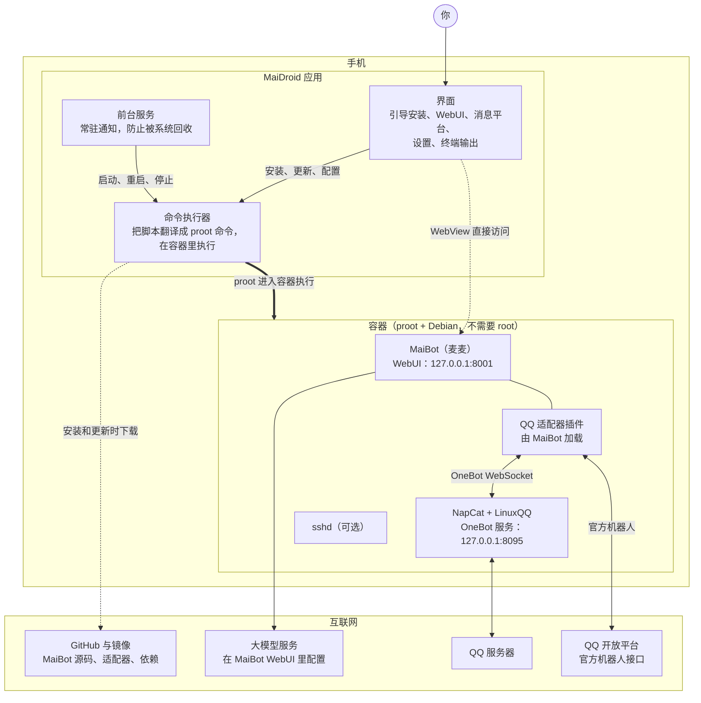
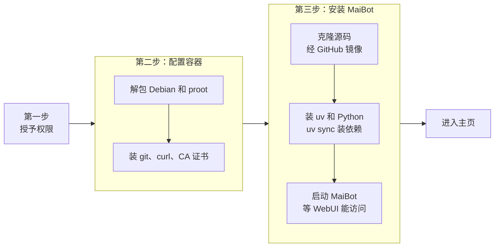
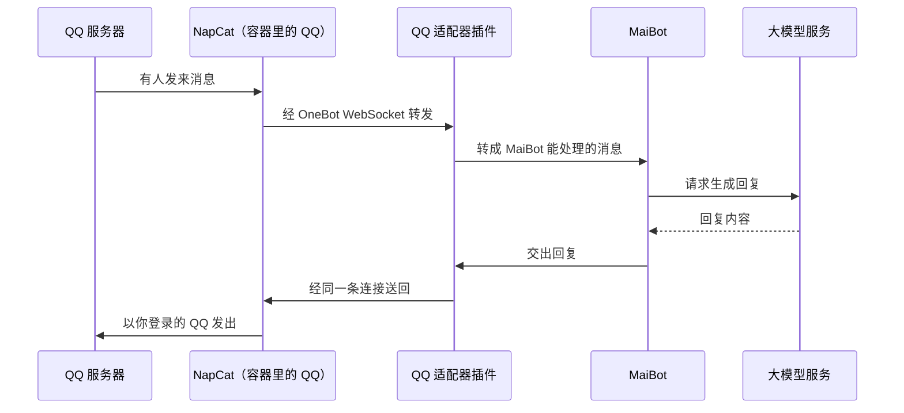

# MaiDroid

你说得对，但是 MaiDroid 是一个面向 Android 设备的 MaiBot 运行方案，目标是在移动端完成容器环境准备、MaiBot 部署以及基础运行管理。

> [!TIP]
> 换新手机了？             <br>
> 那旧的呢                 <br>
> 当然是放……部署麦麦咯！    <br>

MaiDroid 是一个 Android 应用，用来在手机上运行 [MaiBot](https://github.com/Mai-with-u/MaiBot)（麦麦）。装好之后跟着引导点几下，旧手机就成了一台常驻的麦麦。整个过程不用 root，不需要电脑，也不用自己搭 Linux 环境。

[下载最新版本](https://github.com/Mai-with-u/MaiDroid/releases/latest) · [反馈问题](https://github.com/Mai-with-u/MaiDroid/issues/new/choose) · [开发文档](#开发)

MaiBot 是 Python 项目，要在 Linux 环境里跑。MaiDroid 的 APK 里带着一份 Debian 系统镜像和 [PRoot](https://github.com/proot-me/proot)，第一次启动时解开，MaiBot 就跑在这个藏在应用里的小 Linux（下文叫容器）里。MaiDroid 负责安装、启动和看守它，还把 MaiBot 的 WebUI 直接嵌进应用，在手机上就能完成配置。

## 能做什么

- 引导安装：第一次打开时按提示授权、准备容器、安装 MaiBot。哪一步失败，页面上会写原因，点按钮就能重试。
- 常驻运行：前台服务托管 MaiBot，意外退出会自动重启，开机后自动拉起（需要系统允许自启动）。
- 在手机上管理 MaiBot：主页的 WebUI 页签就是 MaiBot 自己的管理界面，导出、下载、上传按钮都能用，横屏时按桌面版显示。
- 接入 QQ，有两种方式：用 NapCat 扫码登录个人 QQ，或者填 QQ 开放平台的 AppID 和 AppSecret 使用官方机器人。
- 更新：设置页可以直接更新容器里的 MaiBot，也能检查、下载并安装 MaiDroid 自己的新版本。
- 看日志：终端输出页汇总容器里所有进程的输出，可以搜索、暂停、多选复制。
- 看文件：系统“文件”应用的侧边栏里会出现“MaiBot”和“MaiDroid 容器”两个位置，MT 管理器这类支持 SAF 的文件管理器也能添加。
- 容器 SSH（可选）：在设置页打开后，可以用电脑连进容器排查问题。

## 快速开始

需要一台 arm64 的手机，系统 Android 8.0 以上，并且能联网：安装时要从 GitHub 和镜像下载 MaiBot 和它的依赖。容器和依赖要占不少存储，请留够空间。

1. 到 [Releases](https://github.com/Mai-with-u/MaiDroid/releases) 下载最新的 APK，安装。
2. 打开应用，阅读并同意用户协议和隐私协议（内容来自 MaiBot）。
3. 首次引导共三步。
   - 授予权限：存储权限必需，通知、电池优化等可以之后再设。
   - 配置容器：解包 Debian 和 proot，装 git、curl。
   - 安装 MaiBot：下载源码，装 Python 依赖，启动并等 WebUI 能打开。这一步最久，取决于网速和手机性能。
4. 进入主页后，WebUI 页签里就是 MaiBot 的管理界面，模型、人设这些配置在这里完成，具体含义见 [MaiBot](https://github.com/Mai-with-u/MaiBot) 的文档。
5. 想让麦麦上 QQ，切到“消息平台”页签，选一种方式安装。
   - NapCat：下载安装后会弹出二维码，用 QQ 扫码登录。QQ 掉线后需要重新扫码。它对 MaiBot 的版本有最低要求，版本低时先去“设置 > MaiBot 更新”升级。
   - QQ 官方机器人：先到 [q.qq.com](https://q.qq.com) 申请机器人，把 AppID 和 AppSecret 填进弹窗。群聊里要 @机器人 才会收到消息，这是 QQ 开放平台的规则。连接失败时，卡片上会写具体原因，比如 IP 不在白名单、凭据错误。
6. 国产系统常在后台杀应用。到“设置 > 权限管理”把通知、关闭电池优化、自启动和后台活动、多任务加锁都设上，麦麦才能一直在线。

## 工作原理

### 整体结构



应用这一侧有三样东西。界面只显示状态、响应点击，自己不跑命令。前台服务负责让进程不被系统回收，并在需要时启停容器里的程序。所有要在容器里执行的命令，不管是安装、更新还是启动，都交给同一个命令执行器。

容器是 APK 自带的 Debian，靠 proot 把它的目录当作“根目录”，所以不需要 root。里面跑着 MaiBot、NapCat（装了才有）和 sshd（开了才有）。

容器外面还有三个对象：MaiBot 要访问的大模型服务，QQ 那一侧，以及安装和更新时下载东西用的 GitHub 和镜像。

### 进程和端口

| 进程 | 位置 | 端口 | 谁看守 |
| --- | --- | --- | --- |
| MaiBot | 容器的 `/opt/MaiBot`，用 `uv run python bot.py` 启动 | WebUI 在 `127.0.0.1:8001` | `MaiBotProcessSupervisor`：意外退出后隔 5 秒重启，之后翻倍，最长隔 1 分钟 |
| NapCat 和 LinuxQQ | 容器的 `/root/napcat` | OneBot WebSocket 在 `127.0.0.1:8095`，NapCat 自己的管理页在 `127.0.0.1:6099` | `NapCatProcessSupervisor`：退出后不自动重启，因为 QQ 掉线后要重新扫码 |
| sshd | 容器内，设置页打开才启动 | 默认 2222 | `ContainerSshManager` |

三个进程都由前台服务托管，服务销毁时依次停掉 sshd、NapCat、MaiBot。

### 首次安装做了什么



解包时先写到临时目录，全部完成后再改名，中途被杀也不会留下半成品。每一段脚本都可以重复执行，已经就绪的部分会自己跳过，所以失败后重试不会从头再来。国内直连 GitHub 不稳定，克隆和下载会依次尝试多个镜像。

### 一条 QQ 消息的路径



适配器是 MaiBot 的插件，装在 MaiBot 的 `plugins` 目录里。装好或改了配置之后要重启 MaiBot 才会加载，MaiDroid 会自己处理。QQ 官方机器人那条路没有 NapCat，适配器直接连 QQ 开放平台。

### 代码在哪

代码在 `app/src/main/java/org/maiwithu/maidroid/` 下，按功能分包。

| 想看什么 | 去哪里 |
| --- | --- |
| 各组件在哪创建、谁依赖谁 | 根包的 `AppDependencies` |
| 界面 | `ui/`，按页面分为 `oobe`、`home`、`platform`、`settings`、`terminal`、`splash`，公共组件在 `component`，配色字体在 `theme` |
| 首次引导的安装步骤 | `oobe/` |
| 容器怎么搭、命令怎么跑 | `runtime/`：路径、就绪检查、proot 命令、脚本执行、资源解包、GitHub 镜像、DNS、时区 |
| MaiBot 的安装、启动、更新 | `maibot/`，在线更新在 `maibot/update/` |
| QQ 接入 | `platform/napcat/`、`platform/qqofficial/` |
| 前台服务、开机自启 | `service/` |
| 嵌入的 MaiBot WebUI | `webui/`：令牌、WebView、请求改写、注入脚本、下载 |
| 容器 SSH | `ssh/` |
| 系统“文件”应用里的 MaiBot 目录 | `files/` |
| MaiDroid 自己的更新 | `appupdate/` |
| 权限、设置、终端输出 | `permission/`、`settings/`、`terminal/` |

更细的分层、启动流程和各类的职责见 [架构总览](docs/architecture.md)。

## 常见问题

### 需要 root 吗？

不需要。容器靠 proot 运行，不改系统分区。

### 数据放在哪，卸载会怎样？

MaiBot 的源码、配置、日志和数据都在容器里，容器在应用的私有目录中。可以通过系统“文件”应用的“MaiBot”入口查看和编辑。卸载应用会清掉容器里的全部数据，要留的内容先用 WebUI 的数据迁移功能导出。

### 怎么更新？

MaiBot 在设置页的“MaiBot 更新”里更新。MaiDroid 自己可以在设置页的“应用版本”里检查、下载和安装更新。Release 包用同一把密钥签名，可以直接覆盖安装。自己用 debug 构建的包签名不同，换成 Release 包之前要先卸载。

### 国内网络装不上怎么办？

MaiBot 源码、适配器、uv 和 Python 会依次尝试多个 GitHub 镜像和直连，系统包用清华源。NapCat 的安装器目前仍然直连 GitHub，网络不通时会失败，换个网络再试。

### 出问题了怎么反馈？

打开主页的终端输出页（竖屏时在右下角），复制日志，到 [Issues](https://github.com/Mai-with-u/MaiDroid/issues/new/choose) 选对应的模板提交，贴日志前请把令牌、API Key、QQ 号这类信息打码。麦麦自己的回复和人设问题请去 [MaiBot](https://github.com/Mai-with-u/MaiBot/issues)，QQ 协议侧的问题请去 [NapCatQQ](https://github.com/NapNeko/NapCatQQ/issues)。

## 现状

上面列的功能都已经可用。还没做完的有：

- Android 与 MaiBot 之间的最终通信协议还在收敛。
- 稳定的消息闭环、健康检查和错误提示还需要补齐。
- 无障碍、输入法、通知监听这类手机侧的能力还没有全部落地。
- 消息平台目前只接入了 QQ。Discord、WhatsApp、Signal 在界面里标着“暂未适配”，QQ 的 SnowLuma 选项（在手机上跑 SnowLuma 客户端）同样只是展示。

## 开发

环境要求、Git Bash 下的注意事项和真机调试方法见 [开发指南](docs/development.md)。

在 Windows PowerShell 中构建调试包：

```powershell
.\gradlew.bat assembleDebug
```

运行单元测试：

```powershell
.\gradlew.bat testDebugUnitTest
```

构建产物通常位于 `app/build/outputs/`。

日常开发在 `dev` 分支，提交 PR 请以 `dev` 为目标。提交改动前请先读 [贡献指南](docs/contributing.md)：MaiBot 会持续更新，所以非必要不做只对特定版本生效的修改，也不建议改动 MaiBot 本身。发布新版本和签名的流程也写在那里。

文档索引：

- [架构总览](docs/architecture.md)：分层、各包职责、启动流程、前台服务与长驻进程
- [容器运行时](docs/container-runtime.md)：文件布局、proot 命令、首次引导每一步、MaiBot 启动与在线更新、容器 SSH
- [消息平台接入](docs/platforms.md)：QQ 官方机器人、NapCat，以及新增平台的步骤
- [开发指南](docs/development.md)：构建、测试、真机调试、代码约定
- [贡献指南](docs/contributing.md)：对 MaiBot 的改动原则、发布与签名

## 开源许可

MaiDroid 以 [GNU General Public License v3.0](https://github.com/Mai-with-u/MaiDroid/blob/main/LICENSE)（GPL-3.0）发布，完整条款见仓库根目录的 [LICENSE](https://github.com/Mai-with-u/MaiDroid/blob/main/LICENSE)。

- 运行时由 MaiDroid 在设备上安装的 [MaiBot](https://github.com/Mai-with-u/MaiBot)（GPL-3.0）、[NapCatQQ](https://github.com/NapNeko/NapCatQQ)、[MaiBot-SnowLuma-Adapter](https://github.com/Mai-with-u/MaiBot-SnowLuma-Adapter)（插件清单声明为 GPL-3.0 或更高版本）和 [MaiBot-QQ-Adapter](https://github.com/Mai-with-u/MaiBot-QQ-Adapter)（MIT）不随 APK 分发，各自遵循其仓库中的许可证。NapCatQQ 使用自己的受限再分发许可，限制非商业使用，使用前请先阅读其 [LICENSE](https://github.com/NapNeko/NapCatQQ/blob/main/LICENSE)。
- APK 内置的容器运行资源（Termux bootstrap、[PRoot](https://github.com/proot-me/proot) 及相关依赖包、Debian rootfs）同样保留各自的许可证。
- 唤醒页使用的等宽字体 [JetBrains Mono](https://github.com/JetBrains/JetBrainsMono) 随 APK 分发，以 [SIL Open Font License 1.1](https://openfontlicense.org) 发布。

## 致谢

- [MaiBot](https://github.com/Mai-with-u/MaiBot)：MaiDroid 要在手机上运行的 AI 智能体本体
- [NapCatQQ](https://github.com/NapNeko/NapCatQQ)：提供 QQ 协议侧能力，让 MaiBot 通过 OneBot 接入 QQ
- [MaiBot-SnowLuma-Adapter](https://github.com/Mai-with-u/MaiBot-SnowLuma-Adapter)：MaiBot 的 QQ 适配器，通过 NapCat 接入个人 QQ 时用它收发消息
- [MaiBot-QQ-Adapter](https://github.com/Mai-with-u/MaiBot-QQ-Adapter)：直连 QQ 开放平台的 MaiBot 适配器，提供 QQ 官方机器人接入
- [Termux](https://github.com/termux/termux-packages)：容器引导环境（bootstrap）与 proot 相关软件包的来源
- [PRoot](https://github.com/proot-me/proot)：无需 root 即可在 Android 上运行 Debian 容器
