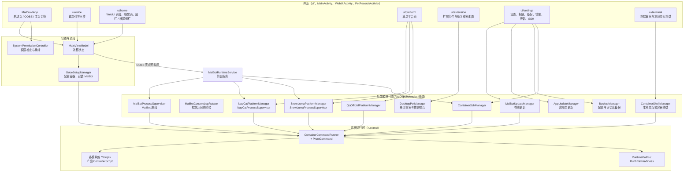

# MaiDroid 架构总览

MaiDroid 在 Android 手机上跑 MaiBot：APK 里带着一个 Debian rootfs 和 proot，首次启动时解包成容器，在容器里装好 MaiBot，再用前台服务让它常驻；界面负责引导安装、嵌入 MaiBot 的 WebUI、接入 QQ 等消息平台。

这份文档讲“代码怎么分层、各包管什么、一次启动经过哪些类”。容器怎么搭、脚本怎么跑见 [container-runtime.md](container-runtime.md)，消息平台接入见 [platforms.md](platforms.md)，本地构建和调试见 [development.md](development.md)。

## 分层

从下往上：

1. **容器运行时**（`runtime/`）只知道“文件在哪、东西齐没齐、怎么在容器里跑一段 shell 脚本”，不知道 MaiBot、NapCat、SnowLuma 是什么。
2. **功能模块**（`maibot/`、`platform/`、`ssh/`）各自写好自己的容器脚本（`*Scripts`，返回 `ContainerScript`），交给 `ContainerCommandRunner` 执行，并把结果整理成界面要的状态（`StateFlow`）。
3. **前台服务**（`service/`）托管长驻进程：MaiBot、NapCat、SnowLuma、sshd。所有“把 MaiBot 拉起来 / 重启”的入口都经 `MaiBotRuntimeService.start(...)`。
4. **界面**只读状态、调用模块的方法，不直接跑命令。

## 包结构

| 包 | 职责 | 主要类 |
| --- | --- | --- |
| （根） | 进程入口、依赖创建处、核心 Activity，以及系统栏同步、高刷新率请求与版本号比较 | `MaiDroidApplication`、`AppDependencies`、`MainActivity`、`MainViewModel`、`WebUiActivity`、`SystemBars.kt`（`applySystemBars`、`LocalHideNavigationBar`）、`DisplayRefreshRate.kt`、`VersionNumber` |
| `settings` | MMKV 持久化的应用设置与外观主题策略模型 | `AppSettings`、`AppThemeMode.kt`（`AppThemeMode`、`resolveUseDarkTheme`） |
| `terminal` | 全应用共享的终端日志输出、ANSI 解析，以及本机交互式容器 Shell 会话管理（基于 Termux 终端引擎） | `TerminalLog`、`AnsiText`、`ContainerShellManager` |
| `permission` | 存储、通知、悬浮窗、电池优化等系统权限的检查和跳转 | `SystemPermissionController`、`PermissionState`、`PermissionActions` |
| `runtime` | 容器运行时：路径、就绪检查、proot 命令与交互 Shell 参数、脚本与挂载定义、回环直连免代理、子进程巡检与终止、原子落盘与 dpkg 修复、存储空间与字节格式化、GitHub / APT / PyPI 镜像管理与测速、容器 DNS 和时区、手机网络状态 | `RuntimePaths`、`InContainerPaths`、`RuntimeReadiness`、`ProotCommand`、`ContainerScript`（含 `ContainerBindMount`）、`ContainerCommandRunner`、`LoopbackHttp.kt`（`isLoopbackHost`、`openDirectOrDefault`）、`OwnChildProcesses.kt`、`ProcessTermination.kt`、`DurableFiles.kt`、`DpkgState`、`StorageSpace.kt`（`StorageSpace`、`formatBytes`）、`RuntimeAssetInstaller`、`MirrorConfig.kt`、`MirrorManager`、`MirrorSpeedTester`、`GitHubMirrors`、`AptMirrors`、`PyPiMirrors`、`ContainerSetupScripts`、`ContainerDns`、`ContainerTimeZone`、`NetworkStatus` |
| `diagnostics` | 出了问题时帮用户说清楚：终端输出落盘、MaiDroid 闪退记录、失败的错误码和认原因的规则表、诊断报告（打码）与诊断包、预填好的 GitHub Issue 链接 | `DiagnosticsManager`、`FailureCodes.kt`（`Failure`、`FailureStep`、`FailureCause`）、`FailureRules.kt`、`LogRedactor`、`DiagnosticReport.kt`、`TerminalLogRecorder`、`TerminalLogFiles`、`CrashRecorder`、`DiagnosticsFiles` |
| `cleanup` | 清理空间：量容器里各类缓存占多少，删掉勾选的 | `StorageCleanupManager`、`StorageCleanupScripts`（含 `CleanupItem`） |
| `backup` | 自动与手动配置/记忆库备份：组件文件规划、在线 SQLite 快照（`VACUUM INTO`）打包、默认外置目录与 SAF 目录双存储、频率/时刻调度与系统任务保底 | `BackupManager`、`BackupModels.kt`、`BackupArchivePlanner`、`BackupArchiver`、`BackupStorage.kt`、`BackupSchedule.kt`、`AutoBackupJobService` |
| `maibot` | MaiBot 本体：多实例发现与选择、安装与启动脚本、依赖安装步骤、进程监管与启动判断、控制台日志轮转、协议 hash、读版本号、插件查找与版本区间校验、插件 config.toml 逐行读写 | `MaiBotInstances`、`MaiBotScripts`、`MaiBotDependencyStep`、`MaiBotProcessSupervisor`、`MaiBotConsoleLogRotator`、`MaiBotStartup.kt`、`MaiBotAgreement`、`MaiBotProjectVersion.kt`、`MaiBotPlugins.kt`、`PluginConfigToml` |
| `maibot.update` | MaiBot 在线更新：手动更新、启动时检查、MaiDroid 更新后的自动升级、正式/测试通道切换 | `MaiBotUpdateManager`、`MaiBotUpdateScripts`、`MaiBotUpdateReport`、`MaiBotChannel` |
| `appupdate` | MaiDroid 应用本体的在线更新：查 GitHub 最新 Release（`AppRelease.kt` 解析）、经镜像下载 APK（`AppUpdateClient`）、校验（`AppPackageCheck.kt`）后交给系统安装器 | `AppUpdateManager`、`AppUpdateClient`、`AppRelease.kt`、`AppUpdateFiles`、`AppPackageCheck.kt` |
| `remote` | 远程公告与动态排障热规则下发（`SHA256withECDSA` 验签、主源 ETag 增量与 GitHub 镜像并发兜底）、脱敏自动报错提取与节流匿名统计（含在线心跳与能耗遥测） | `RemoteOpsManager`、`RemoteOpsClient`、`RemoteManifest.kt`、`ManifestSignatureVerifier`、`AutoErrorExtractor`、`PowerTelemetryTracker` |
| `oobe` | 首次引导的“配置容器”“安装 MaiBot”两步与失败自动重试 | `OobeSetupManager`、`OobeSetupState`、`OobeStep`、`OobeAutoRetry` |
| `files` | 把容器里的文件经 SAF 共享给系统“文件”应用、MT 管理器等文件管理器，以及打开它的入口 | `ContainerDocumentsProvider`、`ContainerDocuments.kt`、`openMaiBotInFileManager` |
| `pet` | 悬浮桌宠运行时：长连接协议与缩放规格、原生消息桥、前端资源与音频分段解析、GPU 舞台物理拖动与撞墙回弹、独立常显传输锚点与悬浮窗、探索记录独立页 | `DesktopPetManager`、`DesktopPetState.kt`、`DesktopPetBridge`、`DesktopPetHost.kt`、`PetAssetResolver`、`PetFlingPhysics.kt`、`PetOverlayService`、`PetWebView`、`PetRecordsActivity` |
| `service` | 前台服务、开机与覆盖安装自启广播、OOBE 通知保活、设置页的安全退出、低电量暂停 | `MaiBotRuntimeService`、`RuntimeAutoStartReceiver`、`SetupKeepAlive`、`SafeExitManager`、`LowBatteryPolicy` |
| `ssh` | 容器里的 sshd | `ContainerSshManager`、`ContainerSshScripts` |
| `platform.qq` | 两种 QQ 协议端（NapCat、SnowLuma 客户端）共用的部分：启用哪一种和切换、自定义来源解析、OneBot 地址与 token、MaiBot 侧连它们的 SnowLuma 适配器（`SnowLumaAdapter*`） | `QqClient.kt`（`QqClient`、`QqClientChoice`）、`QqClientSwitcher`、`QqCustomSource.kt`、`QqOneBot`、`QqAdapterFiles`、`QqAdapterUpkeep`、`SnowLumaAdapterScripts`、`SnowLumaAdapterInstaller`、`SnowLumaAdapterConfig` |
| `platform.napcat` | QQ（NapCat）接入：NapCat 本体 | `NapCatPlatformManager`、`NapCatProcessSupervisor`、`NapCatStatusReader`、`NapCatWebUiClient`、`NapCatScripts`、`NapCatFiles`、`NapCatQrCodeRefresh.kt` |
| `platform.snowluma` | QQ（SnowLuma 客户端）接入：在 Xvfb 上跑 LinuxQQ、让 SnowLuma 注入、宿主维护文件锁替身，读 Xvfb 的屏幕文件把 QQ 窗口显示给用户 | `SnowLumaPlatformManager`、`SnowLumaProcessSupervisor`、`QqProcLocksSync`、`SnowLumaWebUiClient.kt`、`SnowLumaScripts`、`SnowLumaFiles`、`SnowLumaPlatformState.kt`、`QqScreen.kt` |
| `platform.qqofficial` | QQ 官方机器人接入（MaiBot 内置或外置 `MaiBot-QQ-Adapter` 插件） | `QqOfficialPlatformManager`、`QqOfficialAdapterConfig`、`QqOfficialConnectionErrors.kt`、`QqOfficialAdapterScripts`、`QqOfficialAdapterFiles` |
| `webui` | 嵌入 MaiBot WebUI：地址与令牌、进程级 GeckoView 运行时、原生桥接协议、统一会话宿主、网页原生弹窗调度器与模型、横屏桌面版、两指滚动、网页选文件、网页下载与防连崩守卫（配合 `assets/extensions/maidroid/` 内置扩展） | `MaiBotWebUi`、`WebUiRuntime`、`WebUiSessionHost`、`WebUiPromptController`（含 `PromptSettlementGuard`）、`WebUiPromptModels.kt`、`WebUiBridgeProtocol.kt`、`WebUiDesktopViewport`、`WebUiTwoFingerScroll`、`WebUiFileChooser`、`WebUiDownloads`、`WebUiDownloadNames.kt`、`WebUiBlobReceiver`、`WebUiRenderCrashGuard` |
| `ui` | 根界面 | `MaiDroidApp` |
| `ui.oobe` | 首次引导界面和授权弹窗 | `OobeFlowScreen`、`OobeStepParts.kt`、`OobePermissionList.kt`、`OobeTaskList.kt`、`OobeAuthorizationDialog` |
| `ui.home` | 主页外壳、唤醒页（开机自检画面）、竖屏底栏与 WebUI 侧边胶囊几何模型/双向形变及倾角阻尼、横屏侧栏、WebUI 页签 | `HomeScreen`、`WakeMaiPage`、`WakeBootLog.kt`、`HomePortraitNavigation`、`HomePortraitNavLayout.kt`、`HomeNavigationParts.kt`（含底栏、胶囊和侧栏共用的 `HomeTab`、标签按钮、终端按钮）、`PillTiltDamper.kt`、`HomeNavigationRail`、`WebUiTab.kt` |
| `ui.platform` | 消息平台页及其弹窗、网格/页头/搜索与分类积木、协议端弹窗公共壳体与自定义源表单 | `MessagePlatformsPage`、`MessagePlatformsParts.kt`、`PlatformCatalog.kt`（含接入方式 `AccessMethod`）、`AccessMethodSelector`、`PlatformRows.kt`、`PlatformCards.kt`、`PlatformConfigDialogParts.kt`、`QqCustomSourceParts.kt`、`NapCatDialogs.kt`、`SnowLumaDialogs.kt`、`QqOfficialConfigDialog` |
| `ui.extension` | 扩展组件目录、首页与悬浮桌宠配置子页面 | `ExtensionCatalog.kt`、`ExtensionsPage`、`DesktopPetExtensionCard.kt`、`DesktopPetSettingsPage` |
| `ui.diagnostics` | 失败提示（错误码、原因、建议和按钮）、反馈问题弹窗（导出诊断包 zip / GitHub Issue）、QQ 用户反馈群弹窗、闪退后的询问 | `FailureNotice`、`FeedbackDialog`、`QqFeedbackGroupDialog`、`CrashPromptDialog` |
| `ui.remote` | 远程公告横幅、紧急提醒弹窗与受控内置跳转动作解析 | `RemoteAnnouncementViews.kt`、`RemoteActionTarget.kt` |
| `ui.cleanup` | 清理空间与低空间提醒弹窗 | `StorageCleanupDialog`、`LowStorageDialog` |
| `ui.settings` | 设置页与行积木、权限管理、自动备份配置与时间弹窗、镜像源设置、MaiBot 与应用的更新弹窗、容器 SSH 设置、安全退出的按钮与弹窗 | `SettingsPage`、`SettingsRowParts.kt`、`SettingsEmptyDetailPane.kt`、`PermissionManagementPage`、`BackupSettingsPage`、`BackupSettingsParts.kt`、`BackupTimePickerDialog`、`MirrorSettingsPage`、`MirrorSettingsParts.kt`、`MaiBotUpdateDialog`、`AppUpdateDialog`、`ContainerSshSettings.kt`、`SafeExitDialogs.kt` |
| `ui.terminal` | 全屏终端输出与本地交互终端双页滑动视图、顶栏/可展开工具栏与 OOBE 平板布局里的嵌入面板 | `TerminalViewer.kt`（`TerminalOutputScreen`、`TerminalOutputPanel`）、`TerminalViewerToolbar.kt`、`TerminalLogList.kt`、`TerminalViewerState`、`ContainerTerminalPane.kt`、`ContainerTerminalColors.kt` |
| `ui.splash` | 启动页 | `StartupSplashPage` |
| `ui.component` | 跨页面的液态玻璃控件与动效、统一弹窗外壳体系、网页原生液态弹窗、焦点防重入容器、双栏分栏规格与毛玻璃吸顶标题栏 | `LiquidGlass.kt`、`LiquidControls.kt`（`LiquidButton`、`LiquidToggle`）、`LiquidGlassModal.kt`、`LiquidGlassPhysics.kt`、`LiquidHaptics.kt`、`LiquidSlider`、`LiquidSegmentedSelector`、`FocusGuardContent.kt`（`setFocusGuardedContent`）、`HomeTwoPaneSpec.kt`、`NavigationClearance.kt`、`BounceOverscroll.kt`（`BounceOverscrollEffect`）、`CollapsingGlassHeader.kt`、`MaiDialog.kt`、`MaiDialogParts.kt`、`WebUiPromptDialogHost`、`DebugWatermarkBackground.kt`、`FlatFeatureIcons.kt`、`horizontalSlideTransition`、`statusBarTopInset` |
| `ui.theme` | 深浅双色语义色板（`DarkMaiDroidColors` / `LightMaiDroidColors` / `LocalMaiDroidColors`）、字号与圆角阶梯、字体、Material 主题 | `Color.kt`、`Dimens.kt`（`TextSizes`、`Corners`）、`Type.kt`、`MaiDroidTheme` |

表里带 `.kt` 的是文件名（里面是一组顶层函数或几个相关的小类型），其余是类、对象或函数名。

命名约定：`*Manager` 管一项功能的业务流程和界面状态；`*Supervisor` 管一个长驻进程的启停和重启；`*Scripts` 只产出容器脚本；`*Files` 只描述文件位置；`*State` 是给界面的不可变状态。消息平台相关的名字（适配器、接入方式、QQ 适配器）容易混，以 [platforms.md](platforms.md) 开头的术语表为准。

## 依赖从哪来：AppDependencies

所有长生命周期的组件都在 `AppDependencies` 里创建（手动依赖注入），`MaiDroidApplication.onCreate` 里先初始化 MMKV 再创建它。任何地方拿 `context.appDependencies.xxx` 用同一份实例：

- 立即创建：`settings`、`diagnosticsFiles`、`terminalLogRecorder`（一创建就开始把终端输出写进文件）、`crashRecorder`（`MaiDroidApplication` 随后装上闪退记录）、`runtimePaths`、`runtimeReadiness`、`commandRunner`。
- 第一次用时创建（`lazy`）：`mirrorManager`、`maiBotConsoleLogRotator`、`maiBotProcess`、`containerSsh`、`containerShell`、`qqClientSwitcher`、`napCatProcess`、`snowLumaProcess`、`napCat`、`snowLuma`、`qqOfficial`、`maiBotUpdater`、`appUpdater`、`backupManager`、`desktopPet`、`safeExit`、`diagnostics`、`storageCleanup`、`networkMonitor`、`oobeSetup`、`powerTelemetry`、`remoteOps`，以及私有的 `snowLumaAdapterInstaller`（消息平台页安装 NapCat、SnowLuma 和两边启动前换装共用一个，迁移配置靠它的锁串行）、`qqAdapterUpkeep`、`qqClientChoice`。平台管理器一创建就会开始后台轮询，所以要等用户打开对应页面或服务需要时才创建。

新增模块时在这里加一个属性，构造函数里写清依赖，不要再写 `get(context)` 式的单例。

## 一次启动的流程

1. `MaiDroidApplication.onCreate`：初始化 MMKV -> 创建 `AppDependencies` -> 注册前台服务的通知渠道。
2. `MainActivity.onCreate`：按 `AppThemeMode` 同步深浅外观与透明系统栏、请求高刷新率、读一次权限状态，经 `setFocusGuardedContent`（避免卸载聚焦原生视图时焦点回退重入 Compose 提交）进入 `MaiDroidApp`。
3. `MaiDroidApp` 按 `MainViewModel` 的状态切页面：
   - 全新启动先播 1.2 秒启动页（`showStartupSplash`，存在 `SavedStateHandle` 里，旋转屏幕不重播）。
   - OOBE 没完成：显示 `OobeFlowScreen`。没同意过协议时，启动页结束后约 0.4 秒弹出 `OobeAuthorizationDialog`。
   - OOBE 完成：显示 `HomeScreen`。
4. OOBE 三步（`OobeStep`）：
   - **授予权限**：消息通知与忽略电池优化等保活核心权限为必开，外部存储改为可选（在启用默认外置目录备份等需要挂载或写入公共目录的场景按需申请）。点“下一步”时现查一次必开权限。
   - **配置容器**：进入这一步就自动调用 `OobeSetupManager.prepareContainer()`，解包 APK 资源、装系统依赖。
   - **安装 MaiBot**：进入时 `MainViewModel` 先确认容器就绪（没就绪就退回“配置容器”），再调用 `startInstall()`：克隆源码、装依赖、计算协议 hash、拉起 MaiBot、等 WebUI 能访问，最后写 `AppSettings.setupComplete = true`。
   - 两步结束时要么完成、要么有一张失败卡片且页脚按钮可以重试：脚本返回成功后还会按文件核对一次，意外异常也落到失败卡片上，不会停在只能等、没有按钮可点的页面，也不会让应用闪退。
   - 走到哪一步存在 `AppSettings.oobeStep`，闪退、强杀后重开回到那一步接着做；初始化期间挂着保活的前台服务（见“扛得住暴力测试”）。
5. OOBE 完成后（之后每次打开应用都一样），`MainViewModel` 依次：检查一次 MaiDroid 新版本（`AppUpdateManager.checkOnLaunch`）->（MaiDroid 刚更新过、设置里没关自动升级时）先在唤醒页上把 MaiBot 升级到上游最新（`MaiBotUpdateManager.updateAfterAppUpgrade`，期间拦住麦麦的启动）-> 拉起 `MaiBotRuntimeService` ->（没自动升级时）检查一次 MaiBot 新版本（`MaiBotUpdateManager.checkOnLaunch`，只拉取上游提交、不动源码）-> 每 1.5 秒（在线后每 5 秒）探测一次 WebUI（自己的 MaiBot 在跑、端口又能连上才算在线），顺带每分钟看一次剩余空间。查到新版本时 `MaiDroidApp` 在主页上弹更新提醒，两个都有时先弹 MaiDroid 的。“刚更新过”按 `AppSettings.lastLaunchedVersionCode` 判断，判定完立刻记下当前版本号，同一版本只自动升级一次。
6. 主页在 WebUI 第一次在线前显示唤醒页（开机自检画面，`WakeMaiPage`），每 30 秒自动唤醒一次；上线后切到四栏外壳（WebUI、消息平台、扩展组件、设置）。
7. 开机（`ACTION_BOOT_COMPLETED`）或应用覆盖升级（`ACTION_MY_PACKAGE_REPLACED`）后，`RuntimeAutoStartReceiver` 在 OOBE 已完成、`AppSettings.autoStartService` 没关、用户上次没有安全退出时自动拉起前台服务。

## 前台服务与长驻进程

`MaiBotRuntimeService` 每次收到 `start` 都会：挂常驻通知 -> 按设置同步 sshd ->（只同步 SSH 时到此为止）-> 拉起 QQ 协议端（NapCat、SnowLuma 两个监管器都叫一声，只有装好、而且被启用的那个会起来）-> 启动或重启 MaiBot。安全退出开始后例外，见下面的“安全退出”。入口：

| 调用 | 作用 | 谁在用 |
| --- | --- | --- |
| `start(context)` | 启动 QQ 协议端和 MaiBot，已在运行的不重复启动 | OOBE 安装、主页唤醒、开机广播、在线更新结束 |
| `start(context, ACTION_RESTART_RUNTIME)` | 重启 MaiBot（QQ 协议端没跑就拉起） | 装好或改了平台适配器后、切换 QQ 协议端后 |
| `start(context, ACTION_SYNC_CONTAINER_SSH)` | 只按设置启停 sshd | 设置页开关 SSH、改 SSH 配置 |
| `start(context, ACTION_SAFE_EXIT)` | 安全退出：各服务正常退出后关闭 MaiDroid | 设置页“安全退出”（经 `SafeExitManager.request`） |
| `SetupKeepAlive.hold(context)`（`ACTION_SETUP_HOLD`） | 只挂“正在初始化”的通知保活，不启动任何服务；`release()` 后服务没在跑麦麦就自己停 | OOBE 配置容器、安装 MaiBot |

服务以 `specialUse` 前台服务类型运行（避开 Android 15+ `dataSync` 的 6 小时后台运行时限和开机自启限制，并兜底实现 `onTimeout`），同时持有部分唤醒锁（只保 CPU，不亮屏）与低延迟 `WifiLock`（防息屏后 Wi-Fi 深睡断联）；销毁时依次停 sshd、NapCat、SnowLuma、MaiBot；只为保活起的服务销毁时什么都不停。服务启动和网络切换时重写一次容器 DNS。服务活着时还盯着电量和关机，见下面的“低电量暂停与关机”。

几个长驻进程的监管方式：

- **MaiBot**（`MaiBotProcessSupervisor`）：启动、停止、重启都在同一把锁里串行执行，避免同时拉起两个抢端口。意外退出后按 5 秒起、翻倍、最长 1 分钟退避重启，每轮拉起前都在宿主机按同 UID 清理残留 Python 进程（不额外起 proot）。`runWhileStopped { }` 停住 MaiBot 做维护（在线更新），期间所有启动请求被拦下；低电量暂停期间同样拦下（`pauseForLowBattery`），状态里标出 `lowBatteryPaused`。运行状态在 `status`（`MaiBotProcessStatus`）：是否在跑、意外退出的累计次数和最后退出码（主动停止、重启不算）、启动前检查没过时被拦下的原因。OOBE 等 WebUI 时据此判断 MaiBot 是还在起、起来就崩还是根本没拉起，规则在 `MaiBotStartup`。每次拉起前先看 WebUI 端口：自己的 MaiBot 没在跑、端口上却有程序在听，就是被别的程序占着，这时不拉起、在状态里标出 `webUiPortTaken`（OOBE 和唤醒页据此报 `PORT-BUSY`），每 5 秒再看一次，空出来就启动。
- 启动前台服务的入口（OOBE、主页唤醒）都兜住了系统拒绝：应用在后台时 Android 12+ 不让新开前台服务，这时直接让 `MaiBotProcessSupervisor` 启动，回到前台进入主页时再拉服务。
- **NapCat**（`NapCatProcessSupervisor`）：意外退出时按 5 秒起、翻倍、最长 1 分钟退避整树重启，最多连续 3 次（用尽后停在终端日志等手动处理，避免反复强制重登要求重新扫码），稳定运行满 10 分钟计数清零。退出 QQ 登录时只重启它。每次启动前检查 MaiBot 侧的适配器，早期版本装的 MaiBot-Napcat-Adapter 会换成 SnowLuma 适配器（MaiBot-SnowLuma-Adapter），换完重启 MaiBot（见 platforms.md）。只有启用的是 NapCat 才启动（`QqClientChoice`）。
- **SnowLuma**（`SnowLumaProcessSupervisor`）：和 NapCat 二选一，只有启用的是 SnowLuma 才启动；容器启动脚本内由 `wait -n` 事件驱动保育节点（node 挂掉时原地重启、保住 QQ 登录态，连续失败 3 次再请 QQ 退出走整树重启），宿主侧按退避整树重启并在连续 3 次用尽后冷却 10 分钟再自动重试；`/proc/locks` 替身（`RuntimePaths.procLocksStandIn`）由宿主协程 `QqProcLocksSync` 维护。启动前同样检查适配器（两边共用 `QqAdapterUpkeep`）。“重启 QQ”时只重启它。WebUI 默认端口被别的程序占着时换一个空端口启动。
- **sshd**（`ContainerSshManager`）：按设置启停，失败原因显示在设置页。

容器内的长驻进程（MaiBot、NapCat、SnowLuma）通过 `ContainerScript.excludeTopCpuCluster` 排除最高频 CPU 簇以留在中小核省电降温。当长驻容器进程非主动停止却收到 `SIGKILL(137)` 时，`OwnChildProcesses.logUnexpectedSigkill` 会打一行当前应用子进程水位日志协助判断是否逼近系统幻影进程上限；`DiagnosticsManager` 也会在 Android 11+ 读取 `ApplicationExitInfo` 补充上次进程退出原因。

停止长驻进程（停止、重启、在线更新前、安全退出、服务销毁）时要在容器里直接给进程发信号：宿主侧 `Process.destroy()` 只能给 proot 发 SIGTERM，而 proot 会忽略它，信号到不了容器里的进程；proot 被强杀后容器里的进程也不会跟着结束，而是脱离 proot 接着跑（2026-11 真机实测）。所以停止流程是：用 `requestExitScript` 在容器里请进程自己退出 -> 等它保存好数据 -> 兜底用 `Process.killProot()` 强杀还没退的 proot -> 清理残留进程。启动前也会先清一遍上次异常退出留下的残留。

- **MaiBot**（`MaiBotProcessSupervisor.stopLocked`）：用 `MaiBotScripts.requestExit()` 给 Runner（`python bot.py`）发 SIGTERM，Runner 转给 Worker（`python -m src.runtime`）并等它走完优雅关闭（停插件运行时、持久化 A_Memorix 记忆、关数据库），Runner 与 proot 随之依次退出。空闲时约 3 秒；最多等 80 秒（MaiBot 自己给 Worker 留 60 秒）。外层 proot/sh 包装命令行靠 `MaiBotScripts.EXIT_TARGET` 排除。Runner 还没起来（uv 还在同步依赖）或超时就强杀。清理残留由宿主机直接按同 UID 与 `MaiBotScripts.STALE_PROCESS_PATTERN` 结束残留 Python 进程。
- **NapCat**（`NapCatProcessSupervisor.stopLocked`）：用 `NapCatScripts.requestQqExit()` 给 QQ 主进程发 SIGTERM，QQ 正常下线退出（实测 1~2 秒、退出码 0）；launcher.sh 放到后台的 Xvfb 还撑着 proot，再跑一次 `NapCatScripts.cleanup()` 清掉。退出 QQ 登录（只重启 NapCat）也走这条路。
- **SnowLuma**（`SnowLumaProcessSupervisor.stopLocked`）：先用 `SnowLumaScripts.requestSnowLumaExit()` 给 SnowLuma 的两个 node 进程发 SIGTERM，守护进程转给工作进程，工作进程关掉 OneBot、WebUI，写完日志再退出（最多等 20 秒）-> 再用 `requestQqExit()` 请 QQ 主进程下线退出（最多 20 秒）-> 跑 `cleanup()` 清掉 Xvfb、屏幕文件和记下的显示号。真机上还没量过要多久。
- **sshd**：没有要保存的数据，直接强杀 proot 再按名字清理。

### 安全退出

设置页最底下的“安全退出”按钮（`SafeExitButton`，二次确认 `SafeExitConfirmDialog`）。流程在 `SafeExitManager`，由前台服务执行：

1. 确认后 `SafeExitManager.request` 记下 `AppSettings.userExited`，在主线程停掉悬浮桌宠与本地交互终端会话（`containerShell.stopForExit()`），再以 `ACTION_SAFE_EXIT` 拉起前台服务。根界面（`MaiDroidApp`）按 `SafeExitManager.state` 弹出不可取消的进度弹窗（`SafeExitProgressDialog`），只有“切到后台”一个按钮。
2. 服务把常驻通知换成“正在安全退出 MaiDroid”和当前进度，三项服务同时退出：
   - **MaiBot**（`shutdownForExit`）：在线更新还在做就先等它做完，再照上面的方式停止（请 Runner 自己退出、保存好数据）。
   - **QQ**：NapCat、SnowLuma 两个监管器的 `shutdownForExit` 同时跑（没启用的那个本来就没在跑，很快返回），两边的结果合成一项（`mergeExitOutcomes`），有一边被强制停止就算强制停止。
   - **sshd**（`stopForExit`）：照上面的方式停止。
   - 某项没有自己退出（等到超时、找不到要通知的进程）或出错，就强制停止，进度里标成“已强制停止”。
3. 全部停下后服务撤掉通知、停掉自己，在 `onDestroy` 之后调用 `closeMaiDroid`：从最近任务里移除 MaiDroid 的界面，结束进程。
   一定要结束进程：退出一开始，各个监管器就永久拦下所有启动请求（唤醒、更新完成后的重启、改时区重启……），进程留着的话，下次打开会复用它，麦麦就拉不起来了。

用户点完退出马上切走或者从最近任务里划掉 MaiDroid 也不影响：前台服务和唤醒锁让进程撑到服务都停完。退出期间服务收到的其他启动请求只会接着退出，返回 `START_NOT_STICKY`，进程万一被系统杀掉也不会重建服务、把麦麦拉起来。`userExited` 为 true 时开机不自动拉起（和强行停止应用后一样，等用户自己打开）；服务收到应用里发来的任何其他启动请求时清掉它。

### 低电量暂停与关机

手机没电关机时系统只给几秒，麦麦来不及保存，内存里的记忆和聊天就丢了。所以 `MaiBotRuntimeService` 活着时注册两个系统广播：

- **电量变化**（`ACTION_BATTERY_CHANGED`，粘性广播，注册时就拿到当前电量）：判断规则在 `LowBatteryPolicy`。电量低于 5%、又没插电时暂停：常驻通知换成“电量低，麦麦和 QQ 已暂停” -> 麦麦、NapCat、SnowLuma 三个监管器的 `pauseForLowBattery` 同时请麦麦、QQ 正常退出（和平常停止一样）并拦下之后的启动请求 -> 都停下后放掉唤醒锁，让手机能睡下。插上电或电量回到 10% 以上时恢复：拿回唤醒锁 -> 解除拦截 -> 等暂停那一轮停完 -> 服务在托管麦麦时照常拉起 QQ 协议端和麦麦。两个阈值隔开一截，电量在 5% 上下跳时不会反复停、启。服务刚起来时电量就很低（开机自启、打开应用），`onCreate` 里先判断，`onStartCommand` 的启动请求直接被拦下，不会拉起来又马上停掉。暂停期间唤醒页的 MaiBot 一行显示 `low battery`，错误码 `MB-BLOCKED/BAT-LOW`；WebUI 页签的横幅显示“电量低，麦麦已暂停”，点唤醒只提示要插电。暂停不算用户退出，不动 `userExited`。
- **关机**（`ACTION_SHUTDOWN`，只发给运行中注册的接收者）：系统正常关机、重启（包括电量耗尽自动关机）前发出，最多等所有接收者 10 秒。服务用 `goAsync` 拖住广播，请麦麦和 QQ（NapCat、SnowLuma 两个监管器都叫）同时正常退出（`stopAndWait`），都停下或满 8 秒就放行关机。只停不拦，万一没真关机，之后的唤醒照样能拉起；下次开机由开机广播照常自启。2026-11 真机实测麦麦 3 秒、QQ 1 秒退完。

直接断电、系统崩溃不会有任何通知，仍然只能靠“扛得住暴力测试”里的规则在重开后恢复。

## 界面状态的流向

- 模块用 `StateFlow` 暴露状态（`NapCatPlatformState`、`SnowLumaPlatformState`、`QqOfficialPlatformState`、`MaiBotUpdateState`、`ContainerSshState`、`OobeSetupState`），界面 `collectAsState()` 读。
- 界面动作直接调用模块方法（`installNapCat()`、`saveCredentials()`、`applyUpdate()`……），模块内部用自己的协程作用域跑，离开页面也不会中断。
- 权限状态不进 ViewModel：它依赖 Activity（结果回调要在 Activity 启动前注册），放在 `SystemPermissionController` 里，用 Compose 状态保存，`onResume` 时刷新。

## 持久化

只有 `AppSettings`（MMKV 默认实例）。键名已经在用户设备上存在，改名会丢数据：

| 键 | 含义 | 默认 |
| --- | --- | --- |
| `setup_complete` | OOBE 已完成 | false |
| `authorization_accepted` | 已同意用户协议和隐私协议 | false |
| `service_auto_start` | 开机自启（目前没有界面开关） | true |
| `container_ssh_enabled` | 容器 SSH 开关 | false |
| `container_ssh_configured` | 保存过 SSH 端口和密码 | false |
| `container_ssh_port` | SSH 端口（1024~65535） | 2222 |
| `container_ssh_root_password` | 容器 root 密码 | 空 |
| `last_launched_version_code` | 上次打开主界面时 MaiDroid 的 versionCode，比当前小说明刚更新过（决定要不要自动升级 MaiBot） | 0 |
| `maibot_auto_update_disabled` | 关闭 MaiDroid 更新后的 MaiBot 自动升级（设置页“应用版本”弹窗底部的开关） | false |
| `user_exited` | 用户在设置页安全退出了、之后还没再用过 MaiDroid；为 true 时开机不自动拉起 | false |
| `oobe_step` | OOBE 走到哪一步（`OobeStep` 的名字），闪退、强杀后重开回到这一步 | 空 |
| `napcat_custom_source_url` | 用户保存的 NapCat 自定义仓库或 `.zip` 直链 | 空 |
| `snowluma_custom_source_url` | 用户保存的 SnowLuma 自定义仓库或 `.tar.gz`/`.tgz` 直链 | 空 |
| `webui_pill_dock_right` | 竖屏 WebUI 侧边悬浮胶囊是否停靠在右侧（默认左侧） | false |
| `webui_pill_vertical_bias` | 竖屏 WebUI 侧边悬浮胶囊的纵向位置比例（0~1） | 0.65 |
| `desktop_pet_bot_id` | 悬浮桌宠上次选中的本机机器人 ID | 空 |
| `desktop_pet_client_id` | 悬浮桌宠持久化客户端 ID（32 位十六进制） | 首次生成 |
| `desktop_pet_scale` | 悬浮桌宠显示缩放比例（`0.60~1.30`） | 1.0 |
| `keep_screen_on` | 前台打开界面时是否阻止系统息屏（引导阶段自动常亮） | false |
| `wifi_lock_enabled` | 后台运行期间是否持有低延迟 `WifiLock` | false |
| `theme_mode` | 外观主题策略（`AppThemeMode`：`system` / `light` / `dark`） | `system` |
| `mirror_{github,apt,pypi}_{mode,preset,custom}` | 三类镜像源的选择模式（自动测速 / 固定预设 / 自定义地址）、选中预设与自定义 URL | `auto` / 空 / 空 |
| `backup_auto_enabled` | 是否启用定时自动备份 | false |
| `backup_schedule_frequency` / `backup_schedule_day_of_week` | 自动备份频率（`every_6h`/`every_12h`/`daily`/`weekly`）与每周执行日（`1..7`） | `daily` / 7（周日） |
| `backup_schedule_hour` / `backup_schedule_minute` | 自动备份基准时刻（24 小时制） | 4 / 0 |
| `backup_retention_count` | 备份目录自动保留的最近备份份数（`1..30`） | 7 |
| `backup_tree_uri` / `backup_tree_label` | 自定义 SAF 备份目录 Uri 与展示名称（为空时写入默认 `/sdcard/MaiDroid/Backups`） | 空 |
| `backup_include_*` | 是否纳入备份组件（MaiBot 配置/记忆库、插件、SnowLuma、NapCat） | 全部 true |
| `backup_last_*` | 最近自动备份触发槽位 key 与最近备份时间戳/摘要/错误状态 | 空 / 0 |
| `telemetry_enabled` | 是否允许发送无感匿名运行统计与脱敏报错上报（设置页“帮助 > 匿名运行统计”开关） | true |
| `telemetry_install_id` | 匿名统计使用的随机安装 UUID，重装即变 | 首次生成 |
| `telemetry_last_heartbeat_sec` | 上次成功发送每日存活心跳的时间戳（秒） | 0 |
| `telemetry_last_online_heartbeat_sec` | 上次发送实时在线心跳的时间戳（秒） | 0 |
| `telemetry_last_version_code` / `telemetry_last_version_name` | 上次心跳上报的版本信息，用于在升级后扣减旧版本在线计数 | 0 / 空 |
| `telemetry_last_auto_crash_ms` | 上次已自动补报的崩溃时间戳（毫秒），防跨进程重复上报 | 0 |
| `telemetry_auto_error_day` | 自动错误上报的当日日期（`yyyy-MM-dd`） | 空 |
| `telemetry_auto_error_day_count` | 当日已自动上报的脱敏错误条数（单设备每天上限 8 条） | 0 |
| `telemetry_auto_error_fps` | 最近 32 条已上报错误指纹与时间戳（24 小时同指纹防重） | 空 |
| `remote_manifest_etag` | 上次从远程清单主源拿到的 `ETag`，供条件请求省流 | 空 |
| `dismissed_announcement_ids` | 用户已手动关闭的远程公告 ID 列表（最多留最近 64 条） | 空 |
| `notified_announcement_ids` | 已经向系统状态栏推送过通知的重要公告 ID 列表 | 空 |

其余状态都从文件系统现读（容器是否就绪、平台是否已装、凭据），不另存一份，避免两边不一致。MMKV 文件损坏（断电时写到一半）由 `AppSettingsRecovery` 让 MMKV 丢掉坏的部分接着用，不闪退。

## 日志

- `TerminalLog`：MaiBot、NapCat、SnowLuma、sshd、OOBE、在线更新的输出都写到这里，保留最近 800 行，在主页的终端按钮（竖屏在底栏右端，WebUI 页签里先点右下角的小按钮展开底栏；横屏在左侧导航栏底部）打开的终端输出页查看；每行同时打到 logcat 的 `TerminalLog` 标签。各来源用前缀区分：`[MaiBot]`、`[NapCat]`、`[SnowLuma]`、`[ContainerSSH]`、`[QQ 官方机器人]`、`[MaiBot 更新]`、`[MaiDroid 更新]`、`[GitHub]`。
- QQ 官方机器人靠订阅 `TerminalLog.lines` 识别连接报错，MaiBot 每次启动时打的 `MaiBotProcessSupervisor.PROCESS_STARTED_LOG` 一行用来清掉上一轮的报错。改这些日志文字时要同步检查 `QqOfficialConnectionErrors.kt`。
- WebUI（GeckoView）相关日志在 `MaiDroidWebUi`（`MaiBotWebUi.LOG_TAG`）与 `MaiDroidGecko` 标签；GeckoView 自行拉起的隔离内容子进程会在 `MaiDroidApplication.onCreate` 早期被拦截退出，避免重复初始化 MMKV 与后台组件。
- `TerminalLogRecorder` 把终端输出同时写进 `files/diagnostics/logs/terminal-<启动时间>.log`：每行带时间，每个进程一份，单个文件满 2 MB 接着写 `.2.log`，所有文件合计超过 12 MB 删最旧的。反馈问题时带上最近几份，用户不用自己翻终端。
- MaiDroid 自己闪退时 `CrashRecorder` 把调用栈和最后 80 行终端输出写进 `files/diagnostics/crashes/`（保留 10 份），下次打开主界面时问一次要不要反馈。原生代码闪退（例如内容进程或原生库崩溃把应用一起带走）和应用无响应走不到 Java 的异常处理，由 `recentSystemCrashes` 从系统的进程结束记录（Android 11 起）补上，最近三天内的一样会问。
- 失败时各处往终端写一行 `[MaiDroid] 错误码 <错误码> <说明>`（`Failure.logLine`），诊断报告靠它列出最近几次失败；容器脚本自己换源、重建重试时打一行 `[自动修复] …`。

## 错误码与反馈

错误码是 `<步骤>/<原因>`：前半段 `FailureStep` 说明哪一步失败（如 `UV-SYNC`），后半段 `FailureCause` 是从这一步的输出里认出的原因（如 `NET-DNS`），认不出时只有前半段。失败提示（`FailureNotice`）显示错误码、原因的标题和建议，原因带着跳转时（网络设置、日期时间、清理空间）多一个按钮，旁边是“反馈问题”和“QQ 群反馈”。

- 认原因：`FailureRules.kt` 的规则表按顺序匹配输出的最后 400 行，第一条命中的就是。具体原因（空间满、手机时间不对、数据库降级）排在笼统的网络错误前面，网络错误里按“解析不了 -> 超时 -> 断开 -> 服务器报错”排。MaiBot 跑起来之后反复退出时只在 `MAIBOT_RUNTIME_CAUSES` 里认，它运行时的网络报错（大模型请求超时等）多半不致命。
- 联网步骤开始前先看 `NetworkStatus`：手机根本没连网时直接报 `<步骤>/NET-OFFLINE`，不用等各个镜像都超时。
- 新增失败点：用一个 `FailureStep`（没有合适的就加一个，码要短、全大写、不重复，`FailureCodesTest` 会检查），失败时用 `failureOf(步骤, 说明, 输出)` 生成 `Failure` 放进界面状态，并写一行 `logLine()`，界面放一个 `FailureNotice`。新增原因：先拿到真机日志或 Issue 里的原文，加进规则表并补测试。
- 反馈：`DiagnosticsManager.prepare` 收集版本、设备、权限、网络、容器和进程状态、最近几次进程结束的原因（`ApplicationExitInfo`）、终端日志、MaiBot 最新的日志和闪退记录，经 `LogRedactor` 打码：已知的令牌、密钥、密码、QQ 号原样替换，再按规则替换 API Key、Bearer、URL 里的密钥参数、QQ 号、手机号和公网 IP。“保存诊断包”把报告和全部日志存成脱敏 zip，方便发进用户反馈群或随 Issue 上传；“去 GitHub 反馈”复制报告和日志尾部，打开按 `.github/ISSUE_TEMPLATE/bug_report.yml` 的字段 id 预填好版本、机型、错误码的表单（GitHub 只能预填文本框，下拉选项要用户自己选）；“QQ 群反馈”（`QqFeedbackGroupDialog`，设置页“帮助 > QQ 反馈群”也打开它）展示群号与入群验证答案（优先取 `AppUpdateManager` 查到的最新正式版版本号，未查到时回退当前版本），复制验证答案并打开加群链接。
- 远程公告与热规则：`RemoteOpsManager` 在打开界面及前台服务每小时后台拉取经 ECDSA P-256 签名的远程清单（主源不可达时经 `GitHubMirrors` 并发兜底），验签通过后一方面把 `failureHints` 合并进 `FailureRules.kt`（不发版即可补充新报错的人话建议），另一方面按版本、品牌、协议端筛选当前生效公告展示在设置页/首次引导横幅、根界面强提醒弹窗或系统通知栏。
- 自动脱敏报错上报：`RemoteOpsManager` 在“匿名运行统计”开启时订阅终端失败行、冷启补报未上报的 `CrashRecorder` 记录并监听后台 MaiBot 启动异常，经 `AutoErrorExtractor` 与 `LogRedactor` 严格裁除闪退前终端与聊天内容（MaiBot 启动失败仅抽取纯 Python `Traceback` 或白名单启动行），附带 `buildType` 和 24 小时同指纹冷却/每日 8 条配额发往 `/v1/error-report` 并在服务端按 `(fingerprint, build_type)` 隔离聚合。

## 扛得住暴力测试：断网、闪退、强杀、存储满、断电

用户那边的手机随时会断网、闪退、被系统或用户强行停止、存储满到写不进去、没电直接关机，首次引导（OOBE）出问题的反馈最多。所有功能（包括以后新写的）都要按“每一行代码之后都可能发生这些事”来写，结果只能是两种：重开后自己接着做完，或者停在一个带错误码、有按钮可点的失败提示上。不允许留下“看着装好了、其实只装了一半”的状态，也不允许停在只能干等的界面。

### 规则

1. **“装好了”只认最后一步写的完成标记，或能证明完整的检查**。只看可执行文件在不在会被半截骗过：2026-11 真机在 apt “Setting up ca-certificates” 时强杀，git、curl 已经解包在位，重开后直接判定容器就绪，dpkg 半装状态一直拖到下次用 apt 才暴露。现在 `DpkgState` 看 dpkg 有没有做完，依赖看 site-packages 里有没有包，NapCat 看 `napcat_ready` 加 OneBot 配置，SnowLuma 看 `snowluma_ready` 加入口文件和 OneBot 配置（发行包先解到临时目录，核对过才换上）。
2. **进度存在文件里，重开后现读**。OOBE 走到哪一步存在 `AppSettings.oobeStep`；其余状态（容器、依赖、平台装没装）都从文件系统现读，不另存一份。
3. **先写到临时位置，做完再改名**。解包到 `debian.tmp`、`termux.tmp`，克隆到 `/opt/MaiBot.tmp`，完成后改名成正式目录；下次开工前先删掉上次留下的临时目录（`RuntimeAssetInstaller.discardStaging`），删正式目录前先删完成标记。
4. **小文件原子写，大批量写完先落盘**。配置、凭据、标记一律用 `writeTextAtomically`（写临时文件 -> fsync -> 原子改名），断电后要么是旧内容、要么是新内容。解包、装 QQ、克隆、装依赖这类大批量写入，完成后先 `flushFileSystems()` 再写完成标记，断电后不会出现“标记在、文件是空的”。
5. **每段容器脚本都假设上次跑了一半**。apt 前先 `dpkg --configure -a`，git 前先清掉打断时留下的 `.lock`，NapCat 没装完的目录只留最新一份备份。在线更新动源码前先把目标提交记进 `maibot-update-pending`，被打断后下次打开不联网接着做完（`MaiBotUpdateScripts.resumeInterrupted`）。
6. **联网的步骤要能断网**。开工前看 `NetworkStatus`，失败时手机已经没网就改报 `NET-OFFLINE`，不让“各镜像都超时”把人带偏。OOBE 断网失败后等网络回来自动重试，其他网络错误隔 30 秒、90 秒各自动重试一次（`OobeAutoRetry`）。所有下载都要有超时：apt 30 秒没动静算失败，curl、git 有低速限制，不能无限等。容器 DNS 在前台服务启动和网络切换时重写（`ContainerDns.refresh`），换了 Wi-Fi 不会还用旧网关。
7. **空间不够要先说**。开工前用 `StorageSpace.shortageFailure` 按预估量检查，不够直接报 `DISK-FULL` 并给“清理空间”按钮；只在看着不够时才扣掉上次已下载的缓存再判断，免得重试时被自己下好的缓存挡住。日志文件写不进去时停一分钟再试（`TerminalLogFiles`），不能把应用带崩。剩余空间低于 300 MB 时进主页提醒一次（`LowStorageDialog`）。
8. **一处出错不能带走全部**。长驻的协程作用域都用 `backgroundScope`（SupervisorJob，未捕获的异常写进终端日志），某个协程出错不会连带停掉 MaiBot 和 NapCat。GeckoView 内容进程崩溃或被系统回收时由 `ContentDelegate.onCrash`/`onKill` 通知宿主释放旧会话并换一个新的 `WebUiSessionHost` 重新加载，2 分钟内连崩 3 次就停下等用户点重试（`WebUiRenderCrashGuard`）。MMKV 文件损坏时由 `AppSettingsRecovery` 恢复，不闪退。
9. **装东西期间保活，但不能指望保活**。OOBE 配置容器、安装 MaiBot 时挂“正在初始化”的前台服务（`SetupKeepAlive`、`ACTION_SETUP_HOLD`）；OOBE 完成后前台服务常驻，装消息平台、在线更新时同样有它撑着。切到后台、从最近任务划掉都不会被杀。强行停止（`am force-stop`）、闪退、断电会把容器里的进程一起带走，这是常态，靠上面几条恢复。
10. **端口、显示号这类全局资源可能被别人占着**。手机上所有应用共用回环端口和抽象 Unix 套接字（另一个 MaiDroid、Termux 里的 MaiBot 或 VNC）。MaiBot WebUI 端口被占时监管器不拉起，报 `PORT-BUSY`，端口空出来自动启动；判“WebUI 在线”必须是自己的 MaiBot 在跑。NapCat、SnowLuma 的 Xvfb 用 `-displayfd` 自己挑空着的显示号；SnowLuma 的 WebUI 默认端口被占时换一个空端口。新功能要用这类资源时也一样：先确认是自己的，被占时说清楚，别人让出来后能自己接上。
11. **失败都要落到界面上**。意外异常也要接住、转成带错误码的失败提示（见“错误码与反馈”），不能把 `ENOENT` 这类底层异常原文直接给用户看。
12. **没电之前先停好**。电量低于 5% 又没插电时先请麦麦和 QQ 保存好数据停下，插上电自动拉起；收到关机广播时再抢几秒请它们退出（见“低电量暂停与关机”）。新加的长驻进程要有数据要保存，也要接进这两处：暂停时停下并拦下启动请求，关机时一起停。

### 怎么测

- **测试包**：临时在 `app/build.gradle.kts` 的 `buildTypes` 里加 `debug { applicationIdSuffix = ".oobetest" }`，打出包名不同的包，和正在用的 MaiDroid 并存，可以随便清数据、强杀，打完还原这个文件。两个包会抢 8001 端口和显示号（第 10 条会接住），内存也更紧：2026-11 实测两套麦麦加两个 QQ 同时跑时，系统杀过一次麦麦。
- **强杀**：`adb shell am force-stop <包名>`。从最近任务里划掉不算数，前台服务在时进程不会死。
- **断网**：`adb shell svc wifi disable`，恢复用 `enable`，测完一定要打开。
- **存储满**：临时调高 `StorageSpace` 里的预估量，或往 `/data` 里写大文件占满空间。
- **内容进程崩溃**：打开 WebUI 后 `adb shell am crash` 或手动结束其内容子进程，验证内容进程崩溃后的自动重开与防死循环上限。
- **断电**：没法直接模拟。进程状态上强杀和断电是一样的；文件完整性靠第 4 条，可以在做到一半时 `adb reboot` 近似（它不走系统的关机流程，不发关机广播）。
- **低电量**：`adb shell dumpsys battery unplug` 再 `adb shell dumpsys battery set level 4`，应该看到麦麦和 QQ 正常退出、通知换成暂停说明；`set level 7` 仍停着，`set ac 1` 模拟插电后自动拉起。测完一定要 `adb shell dumpsys battery reset`。
- **正常关机**：`adb shell svc power reboot` 走系统的关机流程、会发关机广播，盯着 logcat 应该看到麦麦和 QQ 在重启前正常退出。手机设了锁屏密码的话，重启后要解锁一次 MaiDroid 才会自启。

OOBE 和装消息平台每个阶段都要强杀一次，再重开验证：

| 在哪终止 | 重开后应该 |
| --- | --- |
| 解包 Debian | 回到“配置容器”，丢掉没解完的临时目录，从头解包 |
| 容器里 apt 装 Git、curl（解包中、Setting up 中） | 回到“配置容器”，先修好 dpkg 再装，不报 `dpkg was interrupted` |
| 克隆源码 | 回到“安装 MaiBot”，丢掉没下完的源码，重新克隆 |
| 装 Python、装依赖 | 回到“安装 MaiBot”，接着装，已下载的包不重下 |
| 首次启动 MaiBot、等 WebUI | 回到这一步，重新拉起 |
| 正常运行 | 麦麦、NapCat 重新起来 |
| 装 NapCat：下载、装系统依赖、运行安装器、装好后等适配器配置 | 显示中断或失败、能重试；重试能装好，备份只留一份 |
| 在线更新 | 下次打开先离线把这次更新做完 |

## 容器文件共享

容器在应用私有目录里，不 root 的文件管理器看不到。`ContainerDocumentsProvider` 把它经 SAF 共享出去，系统“文件”应用的侧边栏、MT 管理器的“添加本地存储”都能看到两个根：

- **MaiBot**：容器内 `/opt/MaiBot`（日志、插件、配置、数据），设置页“MaiBot 文件”一行直接打开它（`openMaiBotInFileManager`）；
- **MaiDroid 容器**：整个容器根目录，NapCat 等其它文件从这里找。

两个根共用一套 documentId：`container:` 加相对容器根目录的路径，只认规范路径，带 `..`、空段的一律当作不存在。符号链接按容器语义解析：绝对路径相对容器根目录、`..` 到根目录为止，`--link2symlink` 写下的宿主绝对路径换算回容器路径，所以解析结果不会落到容器以外，`/root/storage/shared -> /sdcard` 这类链接也不会把共享存储暴露出去。列目录时隐藏 proot 的 `.l2s.*` 替身文件，删除不跟随链接。容器根目录、MaiBot 目录及其上级不能删除和改名。

provider 由系统在 `Application.onCreate` 之前创建，所以它自己建 `RuntimePaths`，不用 `appDependencies`。

## 应用自更新

设置页“应用版本”一行检查的是 MaiDroid 自己（容器里的 MaiBot 走 `maibot.update`）。流程在 `AppUpdateManager`：

1. 查 `releases/latest`（地址来自 `BuildConfig.APP_UPDATE_API_URL`），只看正式版，标签按 a.b.c 与 `versionName` 比较。Release 说明末尾发布流程追加的校验行给出 APK 和签名证书的 SHA-256。
2. 当前安装包的签名证书和 Release 写的发布证书不一致（debug 包、自己签的包）时不在应用里下载，只给“打开下载页”：系统不允许不同签名的包覆盖安装，换成发布版得先卸载，会清掉容器数据。
3. 下载到 `cacheDir/app-update/MaiDroid-<版本>.apk.part`，断点续传；下完核对大小、SHA-256，再改名为 `.apk` 读出包名、versionCode 和签名，确认是同一签名的更新版本后，经 FileProvider（只共享这个目录）交给系统安装器。没开“安装未知应用”时按钮先跳到系统授权页。
4. 安装开始后系统会结束 MaiDroid 进程，麦麦和 NapCat 随之停止，用户重新打开应用即恢复。

网络部分在 `AppUpdateClient`：查版本和下载都同时向直连和 `GitHubMirrors` 的所有镜像发请求，查版本取最先返回有效 JSON 的那条；下载时每条线路都从断点发 Range 请求，先收满 512 KB 的胜出并接着下完，中途断开或 20 秒没有数据就排除它重新赛跑。ghfast.top 不代理 `api.github.com`，只在下载时有用。

## 嵌入 MaiBot WebUI

WebUI 在容器里监听 `http://127.0.0.1:8001/`，宿主直接经内嵌 Mozilla **GeckoView**（`arm64-v8a`，由 `WebUiRuntime` 按需延迟创建全进程共享 `GeckoRuntime`）访问。打开时：

1. `MaiBotWebUi.launchUrl` 找访问令牌（先读 `host/webui.json`，旧版 MaiBot 读 `data/webui.json`，再从终端日志里找），找到就打开 `/auth?token=…` 自动登录。
2. `WebUiRuntime.ensureBridgeExtension` 注册内置 WebExtension（`assets/extensions/maidroid/`，先挂好 `WebExtension.MessageDelegate` 再放行挂起的首帧 `session.loadUri`）：`content.js` 在 `document_start` 阶段写入缺失的深色 + `future-retro` 主题默认值（不覆盖用户修改过的选择），并根据宿主经原生端口（`maidroid`）下发的 `configure` 消息同步桌面布局宽度与竖屏 `--maidroid-webview-height` 视口补丁（页面里的普通滚动区保持网页自己的尺寸）。
3. 网页的上传按钮（本地聊天室发图片、加表情包等）经 `WebUiPromptController` 的 `PromptDelegate.onFilePrompt` 交给 `WebUiFileChooser`，用宿主注册的 ActivityResult 打开系统选文件页，把选中的 `content://` 地址回传 `FilePrompt.confirm(...)`。JS 与网页原生的 `<select>`、`alert`/`confirm`/`prompt` 与颜色选择器统一由 `WebUiPromptController` 发射给居中液态玻璃卡片 `WebUiPromptDialogHost` 承接，`<input type="date/time">` 由系统 `DatePickerDialog`/`TimePickerDialog` 承接；主窗口与全屏网页同时经 `DisplayRefreshRate.kt` 申请当前分辨率下的最高刷新率。
4. 网页的导出、下载按钮交给 `WebUiDownloads`，最后统一弹系统“另存为”（`ACTION_CREATE_DOCUMENT`，不用存储权限），分两条通路：
   - HTTP 下载响应（如数据迁移导出的 zip）：`ContentDelegate.onExternalResponse(WebResponse)` 立即在后台协程把 `response.body` 流式写入临时缓存文件，并同步在主线程弹出“另存为”，选完位置后等待临时文件落地再复制到目标 Uri 並清理缓存。
   - `blob:`、`data:` 地址（主题、界面设置、日志、表达方式、图片等网页现场生成的文件）：`content.js` 在 `document_start` 向页面主世界注入钩子包住 `URL.createObjectURL` 与 `a[download]` 点击，通过跨隔离界面的事件把数据切片按 base64 经 `sendNativeMessage` 分块送给 `WebUiBlobReceiver` 存成缓存文件，收齐后弹“另存为”。

横屏时 MaiBot WebUI 按桌面版排版：每次加载前 `WebUiSessionHost.applyDesktopViewport` 按视图尺寸用 `WebUiDesktopViewport` 算出布局宽度（保证布局视口不小于 1040 CSS px 宽；1024 是 WebUI 桌面布局断点，多留 16px 余量避免首页卡片挤坏；高度不设下限），在 `GeckoSessionSettings.VIEWPORT_MODE_MOBILE` 下通过原生消息指示 `content.js` 把 `meta[name="viewport"]` 改为 `width=布局宽度`。视图宽度变化（如挖孔安全区晚一帧生效）时原地推送新宽度，仅压矮高度（弹出键盘）时不重算；竖屏、NapCat / SnowLuma 管理页保持手机版。

`WebUiSessionHost` 为 `GeckoView` 安装了两指外层滚动（`WebUiTwoFingerScroll`）：第二根手指按下时给网页内核补发 `CANCEL` 作废单指手势，之后两指竖直位移经原生端口 `twoFingerBegin` / `twoFingerMove` 交给 `content.js` 从两指中点向祖先逐层传递滚动，松手用 `OverScroller` 惯性续滑。`GeckoView` 显式使用 `BACKEND_TEXTURE_VIEW`，保证在 Compose `AnimatedContent` 与深浅色页面容器中不发生 SurfaceView 打洞黑屏；导航与弹窗通过 `rememberSurfaceBackdrop` 复用页面底色源，兼顾液态玻璃质感与高刷新率流畅度。

横屏侧栏底部透出的网页底色同样由 `content.js` 用 1×1 画布转换为 sRGB 经原生端口 `pageBackground` 上报，切换标签时跟着网页一起滑走。主框架错误由 `NavigationDelegate.onLoadError` 与 `ProgressDelegate.onPageStop` 联合判定，WebUI 上线时若上次加载失败则自动重载一次。

弹出键盘时容器按 `WindowInsets.imeAnimationTarget` 只在最终高度缩一次（`WebUiTabPage`）或叠加安全区与 `ime` 内边距（`WebUiActivity`）。内容进程崩溃或被内存回收时，由 `ContentDelegate.onCrash`/`onKill` 配合 `WebUiRenderCrashGuard`（2 分钟最多自动重开 3 次）兜底；主页退后台空闲满 2 分钟且无挂起文件选择/下载时由 `WebUiTabState.hibernateIfIdle` 释放 `WebUiSessionHost`，回到前台或刷新再唤醒。

Compose 里放 `GeckoView` 必须显式设 `MATCH_PARENT` 布局参数（见 `WebUiSessionHost`），否则 Compose 默认补 `WRAP_CONTENT` 会使视图高度塌陷导致页面空白。
