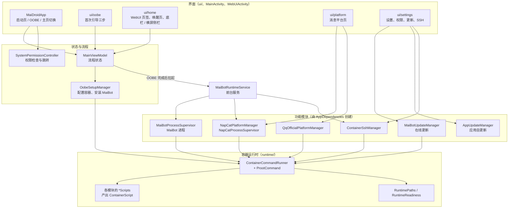

# MaiDroid 架构总览

MaiDroid 在 Android 手机上跑 MaiBot：APK 里带着一个 Debian rootfs 和 proot，首次启动时解包成容器，在容器里装好 MaiBot，再用前台服务让它常驻；界面负责引导安装、嵌入 MaiBot 的 WebUI、接入 QQ 等消息平台。

这份文档讲“代码怎么分层、各包管什么、一次启动经过哪些类”。容器怎么搭、脚本怎么跑见 [container-runtime.md](container-runtime.md)，消息平台接入见 [platforms.md](platforms.md)，本地构建和调试见 [development.md](development.md)。

## 分层

从下往上：

1. **容器运行时**（`runtime/`）只知道“文件在哪、东西齐没齐、怎么在容器里跑一段 shell 脚本”，不知道 MaiBot、NapCat 是什么。
2. **功能模块**（`maibot/`、`platform/`、`ssh/`）各自写好自己的容器脚本（`*Scripts`，返回 `ContainerScript`），交给 `ContainerCommandRunner` 执行，并把结果整理成界面要的状态（`StateFlow`）。
3. **前台服务**（`service/`）托管长驻进程：MaiBot、NapCat、sshd。所有“把 MaiBot 拉起来 / 重启”的入口都经 `MaiBotRuntimeService.start(...)`。
4. **界面**只读状态、调用模块的方法，不直接跑命令。

## 包结构

| 包 | 职责 | 主要类 |
| --- | --- | --- |
| （根） | 进程入口、依赖创建处、两个 Activity，以及两个 Activity 共用的系统栏设置、多个功能共用的版本号比较 | `MaiDroidApplication`、`AppDependencies`、`MainActivity`、`MainViewModel`、`WebUiActivity`、`SystemBars.kt`（`applySystemBars`）、`VersionNumber` |
| `settings` | MMKV 持久化的应用设置 | `AppSettings` |
| `terminal` | 全应用共享的终端输出，以及把 ANSI 控制序列解析成带颜色的行 | `TerminalLog`、`AnsiText` |
| `permission` | 存储、通知、电池优化等系统权限的检查和跳转 | `SystemPermissionController`、`PermissionState`、`PermissionActions` |
| `runtime` | 容器运行时：路径、就绪检查、proot 命令、脚本执行、资源解包、容器 DNS 和时区 | `RuntimePaths`、`RuntimeReadiness`、`ProotCommand`、`ContainerScript`、`ContainerCommandRunner`、`RuntimeAssetInstaller`、`GitHubMirrors`、`ContainerSetupScripts`、`ContainerDns`、`ContainerTimeZone` |
| `maibot` | MaiBot 本体：安装与启动脚本、依赖安装步骤、进程监管与启动判断、协议 hash、读版本号、插件查找、插件 config.toml 逐行读写 | `MaiBotScripts`、`MaiBotDependencyStep`、`MaiBotProcessSupervisor`、`MaiBotStartup.kt`、`MaiBotAgreement`、`MaiBotProjectVersion.kt`、`MaiBotPlugins.kt`、`PluginConfigToml` |
| `maibot.update` | MaiBot 在线更新：手动更新、启动时检查、MaiDroid 更新后的自动升级 | `MaiBotUpdateManager`、`MaiBotUpdateScripts`、`MaiBotUpdateReport` |
| `appupdate` | MaiDroid 应用本体的在线更新：查 GitHub 最新 Release（`AppRelease.kt` 解析）、经镜像下载 APK（`AppUpdateClient`）、校验（`AppPackageCheck.kt`）后交给系统安装器 | `AppUpdateManager`、`AppUpdateClient`、`AppRelease.kt`、`AppUpdateFiles`、`AppPackageCheck.kt` |
| `oobe` | 首次引导的“配置容器”“安装 MaiBot”两步 | `OobeSetupManager`、`OobeSetupState`、`OobeStep` |
| `files` | 把容器里的文件经 SAF 共享给系统“文件”应用、MT 管理器等文件管理器，以及打开它的入口 | `ContainerDocumentsProvider`、`ContainerDocuments.kt`、`openMaiBotInFileManager` |
| `service` | 前台服务和开机广播 | `MaiBotRuntimeService`、`BootCompletedReceiver` |
| `ssh` | 容器里的 sshd | `ContainerSshManager`、`ContainerSshScripts` |
| `platform.napcat` | QQ（NapCat）接入：NapCat 本体（`NapCat*`）和 MaiBot 侧连它的 SnowLuma 适配器（`SnowLumaAdapter*`） | `NapCatPlatformManager`、`NapCatProcessSupervisor`、`NapCatStatusReader`、`NapCatWebUiClient`、`NapCatScripts`、`NapCatFiles`、`NapCatQrCodeRefresh.kt`、`SnowLumaAdapterScripts`、`SnowLumaAdapterInstaller`、`SnowLumaAdapterConfig` |
| `platform.qqofficial` | QQ 官方机器人接入（MaiBot 侧是 MaiBot-QQ-Adapter） | `QqOfficialPlatformManager`、`QqOfficialAdapterConfig`、`QqOfficialConnectionErrors.kt`、`QqOfficialAdapterScripts`、`QqOfficialAdapterFiles` |
| `webui` | 嵌入 MaiBot WebUI：地址与令牌、WebView 创建、请求改写、注入脚本、横屏桌面版、两指滚动、网页底色上报、网页选文件、网页下载 | `MaiBotWebUi`、`createWebUiWebView`、`WebUiWebViewClient`、`WebUiChromeClient`、`WebUiResponseRewriter`、`WebUiInjectedScripts`、`WebUiDesktopViewport`、`WebUiTwoFingerScroll`、`WebUiPageBackground`、`WebUiFileChooser`、`WebUiDownloads`、`WebUiDownloadNames.kt`、`WebUiDownloadScripts`、`WebUiBlobReceiver` |
| `ui` | 根界面 | `MaiDroidApp` |
| `ui.oobe` | 首次引导界面和授权弹窗 | `OobeFlowScreen`、`OobeStepParts.kt`、`OobePermissionList.kt`、`OobeTaskList.kt`、`OobeAuthorizationDialog` |
| `ui.home` | 主页外壳、唤醒页（开机自检画面）、底部导航与横屏侧栏、WebUI 页签 | `HomeScreen`、`WakeMaiPage`、`WakeBootLog.kt`、`HomeBottomNavigation`（含底栏和侧栏共用的 `HomeTab`、标签按钮、终端按钮）、`HomeNavigationRail`、`WebUiTab.kt` |
| `ui.platform` | 消息平台页及其弹窗 | `MessagePlatformsPage`、`PlatformCatalog.kt`（含接入方式 `AccessMethod`）、`AccessMethodSelector`、`PlatformRows.kt`、`PlatformCards.kt`、`NapCatDialogs.kt`、`QqOfficialConfigDialog` |
| `ui.settings` | 设置页、权限管理、MaiBot 与应用的更新弹窗、容器 SSH 设置 | `SettingsPage`、`PermissionManagementPage`、`MaiBotUpdateDialog`、`AppUpdateDialog`、`ContainerSshSettings.kt` |
| `ui.terminal` | 全屏终端输出页与 OOBE 平板布局里的嵌入面板，两者共用同一个终端查看器 | `TerminalViewer.kt`（`TerminalOutputScreen`、`TerminalOutputPanel`）、`TerminalLogList`、`TerminalViewerState` |
| `ui.splash` | 启动页 | `StartupSplashPage` |
| `ui.component` | 跨页面的小组件 | `BackdropBlurView`、`BlurTargetHost`、`horizontalSlideTransition`、`statusBarTopInset` |
| `ui.theme` | 配色、字体、Material 主题 | `Color.kt`、`Type.kt`、`MaiDroidTheme` |

表里带 `.kt` 的是文件名（里面是一组顶层函数或几个相关的小类型），其余是类、对象或函数名。

命名约定：`*Manager` 管一项功能的业务流程和界面状态；`*Supervisor` 管一个长驻进程的启停和重启；`*Scripts` 只产出容器脚本；`*Files` 只描述文件位置；`*State` 是给界面的不可变状态。消息平台相关的名字（适配器、接入方式、QQ 适配器）容易混，以 [platforms.md](platforms.md) 开头的术语表为准。

## 依赖从哪来：AppDependencies

所有长生命周期的组件都在 `AppDependencies` 里创建（手动依赖注入），`MaiDroidApplication.onCreate` 里先初始化 MMKV 再创建它。任何地方拿 `context.appDependencies.xxx` 用同一份实例：

- 立即创建：`settings`、`runtimePaths`、`runtimeReadiness`、`commandRunner`。
- 第一次用时创建（`lazy`）：`maiBotProcess`、`containerSsh`、`napCatProcess`、`napCat`、`qqOfficial`、`maiBotUpdater`、`appUpdater`，以及私有的 `snowLumaAdapterInstaller`（消息平台页安装 NapCat 和启动 NapCat 前换装共用一个，迁移配置靠它的锁串行）。平台管理器一创建就会开始后台轮询，所以要等用户打开对应页面或服务需要时才创建。

新增模块时在这里加一个属性，构造函数里写清依赖，不要再写 `get(context)` 式的单例。

## 一次启动的流程

1. `MaiDroidApplication.onCreate`：初始化 MMKV -> 创建 `AppDependencies` -> 注册前台服务的通知渠道。
2. `MainActivity.onCreate`：常亮屏幕、透明系统栏、读一次权限状态，`setContent` 进入 `MaiDroidApp`。
3. `MaiDroidApp` 按 `MainViewModel` 的状态切页面：
   - 全新启动先播 1.2 秒启动页（`showStartupSplash`，存在 `SavedStateHandle` 里，旋转屏幕不重播）。
   - OOBE 没完成：显示 `OobeFlowScreen`。没同意过协议时，启动页结束后约 0.4 秒弹出 `OobeAuthorizationDialog`。
   - OOBE 完成：显示 `HomeScreen`。
4. OOBE 三步（`OobeStep`）：
   - **授予权限**：存储权限必需，其余可选。点“下一步”时现查一次存储权限。
   - **配置容器**：进入这一步就自动调用 `OobeSetupManager.prepareContainer()`，解包 APK 资源、装系统依赖。
   - **安装 MaiBot**：进入时 `MainViewModel` 先确认容器就绪（没就绪就退回“配置容器”），再调用 `startInstall()`：克隆源码、装依赖、计算协议 hash、拉起 MaiBot、等 WebUI 能访问，最后写 `AppSettings.setupComplete = true`。
   - 两步结束时要么完成、要么有一张失败卡片且页脚按钮可以重试：脚本返回成功后还会按文件核对一次，意外异常也落到失败卡片上，不会停在只能等、没有按钮可点的页面，也不会让应用闪退。
5. OOBE 完成后（之后每次打开应用都一样），`MainViewModel` 依次：检查一次 MaiDroid 新版本（`AppUpdateManager.checkOnLaunch`）->（MaiDroid 刚更新过、设置里没关自动升级时）先在唤醒页上把 MaiBot 升级到上游最新（`MaiBotUpdateManager.updateAfterAppUpgrade`，期间拦住麦麦的启动）-> 拉起 `MaiBotRuntimeService` ->（没自动升级时）检查一次 MaiBot 新版本（`MaiBotUpdateManager.checkOnLaunch`，只拉取上游提交、不动源码）-> 每 1.5 秒（在线后每 5 秒）探测一次 WebUI。查到新版本时 `MaiDroidApp` 在主页上弹更新提醒，两个都有时先弹 MaiDroid 的。“刚更新过”按 `AppSettings.lastLaunchedVersionCode` 判断，判定完立刻记下当前版本号，同一版本只自动升级一次。
6. 主页在 WebUI 第一次在线前显示唤醒页（开机自检画面，`WakeMaiPage`），每 30 秒自动唤醒一次；上线后切到三栏外壳（WebUI、消息平台、设置）。
7. 开机后，`BootCompletedReceiver` 在 OOBE 已完成、开机自启没关时拉起前台服务。

## 前台服务与长驻进程

`MaiBotRuntimeService` 每次收到 `start` 都会：挂常驻通知 -> 按设置同步 sshd ->（只同步 SSH 时到此为止）-> 拉起 NapCat（装了才拉）-> 启动或重启 MaiBot。三种入口：

| 调用 | 作用 | 谁在用 |
| --- | --- | --- |
| `start(context)` | 启动 NapCat 和 MaiBot，已在运行的不重复启动 | OOBE 安装、主页唤醒、开机广播、在线更新结束 |
| `start(context, ACTION_RESTART_RUNTIME)` | 重启 MaiBot（NapCat 没跑就拉起） | 装好或改了平台适配器后 |
| `start(context, ACTION_SYNC_CONTAINER_SSH)` | 只按设置启停 sshd | 设置页开关 SSH、改 SSH 配置 |

服务持有部分唤醒锁（只保 CPU，不亮屏），销毁时依次停 sshd、NapCat、MaiBot。

三个长驻进程的监管方式：

- **MaiBot**（`MaiBotProcessSupervisor`）：启动、停止、重启都在同一把锁里串行执行，避免同时拉起两个抢端口。意外退出后按 5 秒起、翻倍、最长 1 分钟退避重启。`runWhileStopped { }` 停住 MaiBot 做维护（在线更新），期间所有启动请求被拦下。运行状态在 `status`（`MaiBotProcessStatus`）：是否在跑、意外退出的累计次数和最后退出码（主动停止、重启不算）、启动前检查没过时被拦下的原因。OOBE 等 WebUI 时据此判断 MaiBot 是还在起、起来就崩还是根本没拉起，规则在 `MaiBotStartup`。
- 启动前台服务的入口（OOBE、主页唤醒）都兜住了系统拒绝：应用在后台时 Android 12+ 不让新开前台服务，这时直接让 `MaiBotProcessSupervisor` 启动，回到前台进入主页时再拉服务。
- **NapCat**（`NapCatProcessSupervisor`）：不自动重启（QQ 掉线后要重新扫码）。退出 QQ 登录时只重启它。每次启动前检查 MaiBot 侧的适配器，早期版本装的 MaiBot-Napcat-Adapter 会换成 SnowLuma 适配器（MaiBot-SnowLuma-Adapter），换完重启 MaiBot（见 platforms.md）。
- **sshd**（`ContainerSshManager`）：按设置启停，失败原因显示在设置页。

三者停止时都用 `Process.terminateGracefully()`：先 SIGTERM，3 秒后还活着再强杀；启动前还会用脚本按进程名清掉上次异常退出留下的残留。

## 界面状态的流向

- 模块用 `StateFlow` 暴露状态（`NapCatPlatformState`、`QqOfficialPlatformState`、`MaiBotUpdateState`、`ContainerSshState`、`OobeSetupState`），界面 `collectAsState()` 读。
- 界面动作直接调用模块方法（`installNapCat()`、`saveCredentials()`、`applyUpdate()`……），模块内部用自己的协程作用域跑，离开页面也不会中断。
- 权限状态不进 ViewModel：它依赖 Activity（结果回调要在 Activity 启动前注册），放在 `SystemPermissionController` 里，用 Compose 状态保存，`onResume` 时刷新。

## 持久化

只有 `AppSettings`（MMKV 默认实例）。键名已经在用户设备上存在，改名会丢数据：

| 键 | 含义 | 默认 |
| --- | --- | --- |
| `setup_complete` | OOBE 已完成 | false |
| `authorization_accepted` | 已同意用户协议和隐私协议 | false |
| `service_auto_start` | 开机自启（目前没有界面开关） | true |
| `container_ssh_enabled` | 容器 SSH 开关 | false |
| `container_ssh_configured` | 保存过 SSH 端口和密码 | false |
| `container_ssh_port` | SSH 端口（1024~65535） | 2222 |
| `container_ssh_root_password` | 容器 root 密码 | 空 |
| `last_launched_version_code` | 上次打开主界面时 MaiDroid 的 versionCode，比当前小说明刚更新过（决定要不要自动升级 MaiBot） | 0 |
| `maibot_auto_update_disabled` | 关闭 MaiDroid 更新后的 MaiBot 自动升级（设置页“应用版本”弹窗底部的开关） | false |

其余状态都从文件系统现读（容器是否就绪、平台是否已装、凭据），不另存一份，避免两边不一致。

## 日志

- `TerminalLog`：MaiBot、NapCat、sshd、OOBE、在线更新的输出都写到这里，保留最近 800 行，在主页的终端按钮（竖屏在底栏右端，WebUI 页签里先点右下角的小按钮展开底栏；横屏在左侧导航栏底部）打开的终端输出页查看；每行同时打到 logcat 的 `TerminalLog` 标签。各来源用前缀区分：`[MaiBot]`、`[NapCat]`、`[ContainerSSH]`、`[QQ 官方机器人]`、`[MaiBot 更新]`、`[MaiDroid 更新]`、`[GitHub]`。
- QQ 官方机器人靠订阅 `TerminalLog.lines` 识别连接报错，MaiBot 每次启动时打的 `MaiBotProcessSupervisor.PROCESS_STARTED_LOG` 一行用来清掉上一轮的报错。改这些日志文字时要同步检查 `QqOfficialConnectionErrors`。
- WebView 相关日志在 `MaiDroidWebUi` 标签（`MaiBotWebUi.LOG_TAG`）。

## 容器文件共享

容器在应用私有目录里，不 root 的文件管理器看不到。`ContainerDocumentsProvider` 把它经 SAF 共享出去，系统“文件”应用的侧边栏、MT 管理器的“添加本地存储”都能看到两个根：

- **MaiBot**：容器内 `/opt/MaiBot`（日志、插件、配置、数据），设置页“MaiBot 文件”一行直接打开它（`openMaiBotInFileManager`）；
- **MaiDroid 容器**：整个容器根目录，NapCat 等其它文件从这里找。

两个根共用一套 documentId：`container:` 加相对容器根目录的路径，只认规范路径，带 `..`、空段的一律当作不存在。符号链接按容器语义解析：绝对路径相对容器根目录、`..` 到根目录为止，`--link2symlink` 写下的宿主绝对路径换算回容器路径，所以解析结果不会落到容器以外，`/root/storage/shared -> /sdcard` 这类链接也不会把共享存储暴露出去。列目录时隐藏 proot 的 `.l2s.*` 替身文件，删除不跟随链接。容器根目录、MaiBot 目录及其上级不能删除和改名。

provider 由系统在 `Application.onCreate` 之前创建，所以它自己建 `RuntimePaths`，不用 `appDependencies`。

## 应用自更新

设置页“应用版本”一行检查的是 MaiDroid 自己（容器里的 MaiBot 走 `maibot.update`）。流程在 `AppUpdateManager`：

1. 查 `releases/latest`（地址来自 `BuildConfig.APP_UPDATE_API_URL`），只看正式版，标签按 a.b.c 与 `versionName` 比较。Release 说明末尾发布流程追加的校验行给出 APK 和签名证书的 SHA-256。
2. 当前安装包的签名证书和 Release 写的发布证书不一致（debug 包、自己签的包）时不在应用里下载，只给“打开下载页”：系统不允许不同签名的包覆盖安装，换成发布版得先卸载，会清掉容器数据。
3. 下载到 `cacheDir/app-update/MaiDroid-<版本>.apk.part`，断点续传；下完核对大小、SHA-256，再改名为 `.apk` 读出包名、versionCode 和签名，确认是同一签名的更新版本后，经 FileProvider（只共享这个目录）交给系统安装器。没开“安装未知应用”时按钮先跳到系统授权页。
4. 安装开始后系统会结束 MaiDroid 进程，麦麦和 NapCat 随之停止，用户重新打开应用即恢复。

网络部分在 `AppUpdateClient`：查版本和下载都同时向直连和 `GitHubMirrors` 的所有镜像发请求，查版本取最先返回有效 JSON 的那条；下载时每条线路都从断点发 Range 请求，先收满 512 KB 的胜出并接着下完，中途断开或 20 秒没有数据就排除它重新赛跑。ghfast.top 不代理 `api.github.com`，只在下载时有用。

## 嵌入 MaiBot WebUI

WebUI 在容器里监听 `http://127.0.0.1:8001/`，宿主直接访问。打开时：

1. `MaiBotWebUi.launchUrl` 找访问令牌（先读 `data/webui.json`，再从终端日志里找），找到就打开 `/auth?token=…` 自动登录。
2. `WebUiWebViewClient` 让 `WebUiResponseRewriter` 改写请求：HTML 里注入主题、vh 兜底和下载拦截脚本（主题只在 WebUI 还没存过外观设置时写默认值，不覆盖用户的选择）。样式表、脚本等其余请求不改。
3. 页面加载完执行 `WebUiInjectedScripts.viewportPatch`，按真实视口高度修正全屏容器和对话框；页面里的普通滚动区保持网页自己的尺寸。桌面版不执行这一步。
4. 网页的上传按钮（本地聊天室发图片、加表情包等）经 `WebUiChromeClient.onShowFileChooser` 交给 `WebUiFileChooser`，用宿主注册的 ActivityResult 打开系统选文件页，把选中的 `content://` 地址回传网页。WebView 默认不处理文件选择，不接这一步上传按钮点了没反应。
5. 网页的导出、下载按钮交给 `WebUiDownloads`（`createWebUiWebView` 必须传入，它注册 `DownloadListener` 和 JS 桥 `window.MaiDroidDownloads`），最后都弹系统“另存为”（`ACTION_CREATE_DOCUMENT`，不用存储权限）。WebView 没有 `DownloadListener` 时下载请求发出后就被取消，导出按钮点了没反应。分两种：
   - http 地址（数据迁移导出的 zip）：`onDownloadStart` 拿到地址和 `Content-Disposition` 里的文件名 -> 另存为 -> 带上 WebView 的 Cookie（登录态 `maibot_session`）重新请求，边下边写。
   - `blob:`、`data:` 地址（主题、界面设置、日志、表达方式、图片等网页现场生成的文件）：网页点完常常立刻 `revokeObjectURL`，内容只在网页内存里，`onDownloadStart` 也不带 `download` 属性的文件名。所以 `WebUiDownloadScripts` 随页面注入（NapCat 管理页由 service worker 接管，HTML 拦不到，由 `WebUiWebViewClient` 在页面加载完时补装），包住 `URL.createObjectURL` 记下每个 Blob，在 `a[download]` 被点击的那一刻读出内容，分块 base64 经 JS 桥送给 `WebUiBlobReceiver` 存成缓存文件，再另存为。没经过点击拦截的 blob 下载（比如网页派发合成点击事件）落到 `onDownloadStart`，宿主补跑一次脚本按地址取内容，名字按类型猜。

横屏时 MaiBot WebUI 按桌面版排版：每次加载前 `WebUiWebViewClient.applyDesktopViewport` 按 WebView 尺寸用 `WebUiDesktopViewport` 算出布局宽度（保证布局视口不小于 1040 CSS px 宽；1024 是 WebUI 桌面布局的断点，再窄会退回手机版，刚过断点时首页卡片会挤坏，所以多留一点。高度不设下限，WebUI 没有按高度切换的断点），拦截 HTML 时把 viewport meta 换成这个宽度，并打开 WebView 的 `useWideViewPort` 和总览模式，整页按宽度缩进 WebView。加载后 WebView 宽度再变（比如挖孔安全区晚一帧生效）就用脚本就地改写 viewport，不重新加载；只压矮高度（弹出键盘）时不改。竖屏、NapCat 管理页照旧按手机版。

WebView 由 `createWebUiWebView` 统一创建，装了两指滚动（`WebUiTwoFingerScroll`）：第二根手指按下时给网页补一个 CANCEL，之后两指的竖直位移交给注入的脚本，从两指中点往外找可滚动的容器，先滚外层、外层到头再滚里层，松手按系统的 OverScroller 甩出惯性。用来越过占满屏幕、会吃掉单指滑动的子块。

竖屏时 WebUI 页签里 APP 底栏默认收成右下角的小按钮（`CollapsedHomeNavigationButton`），网页自己的底部导航贴着屏幕底边，所以页签和全屏 `WebUiActivity` 都不传让位高度。点小按钮会盖一层遮罩并弹出完整底栏，点遮罩、按返回键、切换标签或打开终端时收起；这个状态在 `HomeTabsShell` 里。

窗口宽大于高时主页导航改成左侧竖栏（`HomeNavigationRail`），和竖屏底栏一样悬浮在 `BlurTargetHost` 上做实时模糊：页面仍铺满整宽，内容左边让出侧栏宽度（`HomeNavigationRailWidth`），切换标签时整页从玻璃底下滑过；WebUI 页签让出的那一条涂网页自己的底色，网页加载完注入 `WebUiPageBackground` 的脚本，换主题时经 console 把底色报给 `WebUiChromeClient`。WebUI 的刷新按钮也挪进侧栏；各页面列表末尾的留白从 `LocalBottomNavigationClearance` 取，侧栏模式下由外壳换成很小的值。横屏时 `MainActivity` 和 `WebUiActivity` 都隐藏状态栏和导航栏（`applySystemBars`），挖孔转到屏幕左右两侧，主页外壳统一按 `safeDrawing` 左右让开。

WebUI 页签顶部按情况显示“WebView 加载失败，重试”或“WebUI 离线，唤醒”。主框架加载失败后 WebView 还会为报错页回调一次 `onPageFinished`，`WebUiWebViewClient` 记着这一轮出过错，不把那次当成加载成功，否则重试条刚出来就被清掉，只剩一片黑。麦麦重启（改时区、换装 SnowLuma 适配器）的十几秒里页签刚好重新加载（切回应用时界面被重建、用户点了刷新）会停在报错页；`WebUiTabPage` 在 WebUI 重新上线时发现上次加载失败，就自动重载一次。只在上线那一刻重载，WebUI 自身出错不会反复刷新。

弹出键盘时 WebView 底部让出键盘高度：主界面是全面屏（`enableEdgeToEdge`），清单里的 `adjustResize` 不再缩小窗口，WebUI 页签按 `WindowInsets.imeAnimationTarget` 给 WebView 加底部内边距，网页可视高度跟着变矮，内核把正在输入的框滚到可见处。按键盘最终高度只缩一次，不随键盘动画逐帧缩放（WebUI 页面重，逐帧重排会卡）；悬浮键盘报上来的高度是 0，不缩。全屏 `WebUiActivity` 的容器内边距也加上了键盘（旧系统由窗口自己缩小，拿到的是 0；Android 15 起强制全面屏后才起作用）。

Compose 里放 WebView 必须显式设 `MATCH_PARENT` 布局参数（见 `WebUiTab.rememberWebUiTabState`），否则 WebView 把页面高度当成 0，vh 恒为 0 整页空白。
