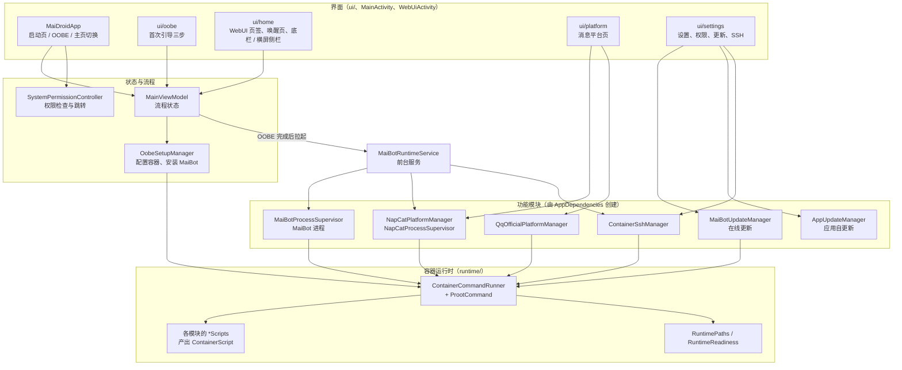

# MaiDroid 架构总览

MaiDroid 在 Android 手机上跑 MaiBot：APK 里带着一个 Debian rootfs 和 proot，首次启动时解包成容器，在容器里装好 MaiBot，再用前台服务让它常驻；界面负责引导安装、嵌入 MaiBot 的 WebUI、接入 QQ 等消息平台。

这份文档讲“代码怎么分层、各包管什么、一次启动经过哪些类”。容器怎么搭、脚本怎么跑见 [container-runtime.md](container-runtime.md)，消息平台接入见 [platforms.md](platforms.md)，本地构建和调试见 [development.md](development.md)。

## 分层

从下往上：

1. **容器运行时**（`runtime/`）只知道“文件在哪、东西齐没齐、怎么在容器里跑一段 shell 脚本”，不知道 MaiBot、NapCat 是什么。
2. **功能模块**（`maibot/`、`platform/`、`ssh/`）各自写好自己的容器脚本（`*Scripts`，返回 `ContainerScript`），交给 `ContainerCommandRunner` 执行，并把结果整理成界面要的状态（`StateFlow`）。
3. **前台服务**（`service/`）托管长驻进程：MaiBot、NapCat、sshd。所有“把 MaiBot 拉起来 / 重启”的入口都经 `MaiBotRuntimeService.start(...)`。
4. **界面**只读状态、调用模块的方法，不直接跑命令。

## 包结构

| 包 | 职责 | 主要类 |
| --- | --- | --- |
| （根） | 进程入口、依赖创建处、两个 Activity，以及两个 Activity 共用的系统栏设置、多个功能共用的版本号比较 | `MaiDroidApplication`、`AppDependencies`、`MainActivity`、`MainViewModel`、`WebUiActivity`、`SystemBars.kt`（`applySystemBars`）、`VersionNumber` |
| `settings` | MMKV 持久化的应用设置 | `AppSettings` |
| `terminal` | 全应用共享的终端输出，以及把 ANSI 控制序列解析成带颜色的行 | `TerminalLog`、`AnsiText` |
| `permission` | 存储、通知、电池优化等系统权限的检查和跳转 | `SystemPermissionController`、`PermissionState`、`PermissionActions` |
| `runtime` | 容器运行时：路径、就绪检查、proot 命令、脚本执行、资源解包、GitHub 和 apt 镜像、容器 DNS 和时区、手机网络状态 | `RuntimePaths`、`RuntimeReadiness`、`ProotCommand`、`ContainerScript`、`ContainerCommandRunner`、`RuntimeAssetInstaller`、`GitHubMirrors`、`AptMirrors`、`ContainerSetupScripts`、`ContainerDns`、`ContainerTimeZone`、`NetworkStatus` |
| `diagnostics` | 出了问题时帮用户说清楚：终端输出落盘、MaiDroid 闪退记录、失败的错误码和认原因的规则表、诊断报告（打码）与诊断包、预填好的 GitHub Issue 链接 | `DiagnosticsManager`、`FailureCodes.kt`（`Failure`、`FailureStep`、`FailureCause`）、`FailureRules.kt`、`LogRedactor`、`DiagnosticReport.kt`、`TerminalLogRecorder`、`TerminalLogFiles`、`CrashRecorder`、`DiagnosticsFiles` |
| `cleanup` | 清理空间：量容器里各类缓存占多少，删掉勾选的 | `StorageCleanupManager`、`StorageCleanupScripts`（含 `CleanupItem`） |
| `maibot` | MaiBot 本体：安装与启动脚本、依赖安装步骤、进程监管与启动判断、协议 hash、读版本号、插件查找、插件 config.toml 逐行读写 | `MaiBotScripts`、`MaiBotDependencyStep`、`MaiBotProcessSupervisor`、`MaiBotStartup.kt`、`MaiBotAgreement`、`MaiBotProjectVersion.kt`、`MaiBotPlugins.kt`、`PluginConfigToml` |
| `maibot.update` | MaiBot 在线更新：手动更新、启动时检查、MaiDroid 更新后的自动升级 | `MaiBotUpdateManager`、`MaiBotUpdateScripts`、`MaiBotUpdateReport` |
| `appupdate` | MaiDroid 应用本体的在线更新：查 GitHub 最新 Release（`AppRelease.kt` 解析）、经镜像下载 APK（`AppUpdateClient`）、校验（`AppPackageCheck.kt`）后交给系统安装器 | `AppUpdateManager`、`AppUpdateClient`、`AppRelease.kt`、`AppUpdateFiles`、`AppPackageCheck.kt` |
| `oobe` | 首次引导的“配置容器”“安装 MaiBot”两步 | `OobeSetupManager`、`OobeSetupState`、`OobeStep` |
| `files` | 把容器里的文件经 SAF 共享给系统“文件”应用、MT 管理器等文件管理器，以及打开它的入口 | `ContainerDocumentsProvider`、`ContainerDocuments.kt`、`openMaiBotInFileManager` |
| `service` | 前台服务、开机广播、设置页的安全退出、低电量暂停 | `MaiBotRuntimeService`、`BootCompletedReceiver`、`SafeExitManager`、`LowBatteryPolicy` |
| `ssh` | 容器里的 sshd | `ContainerSshManager`、`ContainerSshScripts` |
| `platform.qq` | 两种 QQ 协议端（NapCat、SnowLuma 客户端）共用的部分：启用哪一种和切换、OneBot 地址与 token、MaiBot 侧连它们的 SnowLuma 适配器（`SnowLumaAdapter*`） | `QqClient.kt`（`QqClient`、`QqClientChoice`）、`QqClientSwitcher`、`QqOneBot`、`QqAdapterFiles`、`QqAdapterUpkeep`、`SnowLumaAdapterScripts`、`SnowLumaAdapterInstaller`、`SnowLumaAdapterConfig` |
| `platform.napcat` | QQ（NapCat）接入：NapCat 本体 | `NapCatPlatformManager`、`NapCatProcessSupervisor`、`NapCatStatusReader`、`NapCatWebUiClient`、`NapCatScripts`、`NapCatFiles`、`NapCatQrCodeRefresh.kt` |
| `platform.snowluma` | QQ（SnowLuma 客户端）接入：在 Xvfb 上跑 LinuxQQ、让 SnowLuma 注入，读 Xvfb 的屏幕文件把 QQ 窗口显示给用户 | `SnowLumaPlatformManager`、`SnowLumaProcessSupervisor`、`SnowLumaWebUiClient.kt`、`SnowLumaScripts`、`SnowLumaFiles`、`SnowLumaPlatformState.kt`、`QqScreen.kt` |
| `platform.qqofficial` | QQ 官方机器人接入（MaiBot 侧是 MaiBot-QQ-Adapter） | `QqOfficialPlatformManager`、`QqOfficialAdapterConfig`、`QqOfficialConnectionErrors.kt`、`QqOfficialAdapterScripts`、`QqOfficialAdapterFiles` |
| `webui` | 嵌入 MaiBot WebUI：地址与令牌、WebView 创建、请求改写、注入脚本、横屏桌面版、两指滚动、网页底色上报、网页选文件、网页下载 | `MaiBotWebUi`、`createWebUiWebView`、`WebUiWebViewClient`、`WebUiChromeClient`、`WebUiResponseRewriter`、`WebUiInjectedScripts`、`WebUiDesktopViewport`、`WebUiTwoFingerScroll`、`WebUiPageBackground`、`WebUiFileChooser`、`WebUiDownloads`、`WebUiDownloadNames.kt`、`WebUiDownloadScripts`、`WebUiBlobReceiver` |
| `ui` | 根界面 | `MaiDroidApp` |
| `ui.oobe` | 首次引导界面和授权弹窗 | `OobeFlowScreen`、`OobeStepParts.kt`、`OobePermissionList.kt`、`OobeTaskList.kt`、`OobeAuthorizationDialog` |
| `ui.home` | 主页外壳、唤醒页（开机自检画面）、底部导航与横屏侧栏、WebUI 页签 | `HomeScreen`、`WakeMaiPage`、`WakeBootLog.kt`、`HomeBottomNavigation`（含底栏和侧栏共用的 `HomeTab`、标签按钮、终端按钮）、`HomeNavigationRail`、`WebUiTab.kt` |
| `ui.platform` | 消息平台页及其弹窗 | `MessagePlatformsPage`、`PlatformCatalog.kt`（含接入方式 `AccessMethod`）、`AccessMethodSelector`、`PlatformRows.kt`、`PlatformCards.kt`、`NapCatDialogs.kt`、`SnowLumaDialogs.kt`、`QqOfficialConfigDialog` |
| `ui.diagnostics` | 失败提示（错误码、原因、建议和按钮）、反馈问题弹窗、闪退后的询问 | `FailureNotice`、`FeedbackDialog`、`CrashPromptDialog` |
| `ui.cleanup` | 清理空间弹窗 | `StorageCleanupDialog` |
| `ui.settings` | 设置页、权限管理、MaiBot 与应用的更新弹窗、容器 SSH 设置、安全退出的按钮与弹窗 | `SettingsPage`、`PermissionManagementPage`、`MaiBotUpdateDialog`、`AppUpdateDialog`、`ContainerSshSettings.kt`、`SafeExitDialogs.kt` |
| `ui.terminal` | 全屏终端输出页与 OOBE 平板布局里的嵌入面板，两者共用同一个终端查看器 | `TerminalViewer.kt`（`TerminalOutputScreen`、`TerminalOutputPanel`）、`TerminalLogList`、`TerminalViewerState` |
| `ui.splash` | 启动页 | `StartupSplashPage` |
| `ui.component` | 跨页面的小组件 | `BackdropBlurView`、`BlurTargetHost`、`horizontalSlideTransition`、`statusBarTopInset` |
| `ui.theme` | 配色、字体、Material 主题 | `Color.kt`、`Type.kt`、`MaiDroidTheme` |

表里带 `.kt` 的是文件名（里面是一组顶层函数或几个相关的小类型），其余是类、对象或函数名。

命名约定：`*Manager` 管一项功能的业务流程和界面状态；`*Supervisor` 管一个长驻进程的启停和重启；`*Scripts` 只产出容器脚本；`*Files` 只描述文件位置；`*State` 是给界面的不可变状态。消息平台相关的名字（适配器、接入方式、QQ 适配器）容易混，以 [platforms.md](platforms.md) 开头的术语表为准。

## 依赖从哪来：AppDependencies

所有长生命周期的组件都在 `AppDependencies` 里创建（手动依赖注入），`MaiDroidApplication.onCreate` 里先初始化 MMKV 再创建它。任何地方拿 `context.appDependencies.xxx` 用同一份实例：

- 立即创建：`settings`、`diagnosticsFiles`、`terminalLogRecorder`（一创建就开始把终端输出写进文件）、`crashRecorder`（`MaiDroidApplication` 随后装上闪退记录）、`runtimePaths`、`runtimeReadiness`、`commandRunner`。
- 第一次用时创建（`lazy`）：`maiBotProcess`、`containerSsh`、`qqClientSwitcher`、`napCatProcess`、`snowLumaProcess`、`napCat`、`snowLuma`、`qqOfficial`、`maiBotUpdater`、`appUpdater`、`safeExit`、`diagnostics`、`storageCleanup`，以及私有的 `snowLumaAdapterInstaller`（消息平台页安装 NapCat、SnowLuma 和两边启动前换装共用一个，迁移配置靠它的锁串行）、`qqAdapterUpkeep`、`qqClientChoice`。平台管理器一创建就会开始后台轮询，所以要等用户打开对应页面或服务需要时才创建。

新增模块时在这里加一个属性，构造函数里写清依赖，不要再写 `get(context)` 式的单例。

## 一次启动的流程

1. `MaiDroidApplication.onCreate`：初始化 MMKV -> 创建 `AppDependencies` -> 注册前台服务的通知渠道。
2. `MainActivity.onCreate`：常亮屏幕、透明系统栏、读一次权限状态，`setContent` 进入 `MaiDroidApp`。
3. `MaiDroidApp` 按 `MainViewModel` 的状态切页面：
   - 全新启动先播 1.2 秒启动页（`showStartupSplash`，存在 `SavedStateHandle` 里，旋转屏幕不重播）。
   - OOBE 没完成：显示 `OobeFlowScreen`。没同意过协议时，启动页结束后约 0.4 秒弹出 `OobeAuthorizationDialog`。
   - OOBE 完成：显示 `HomeScreen`。
4. OOBE 三步（`OobeStep`）：
   - **授予权限**：存储权限必需，其余可选。点“下一步”时现查一次存储权限。
   - **配置容器**：进入这一步就自动调用 `OobeSetupManager.prepareContainer()`，解包 APK 资源、装系统依赖。
   - **安装 MaiBot**：进入时 `MainViewModel` 先确认容器就绪（没就绪就退回“配置容器”），再调用 `startInstall()`：克隆源码、装依赖、计算协议 hash、拉起 MaiBot、等 WebUI 能访问，最后写 `AppSettings.setupComplete = true`。
   - 两步结束时要么完成、要么有一张失败卡片且页脚按钮可以重试：脚本返回成功后还会按文件核对一次，意外异常也落到失败卡片上，不会停在只能等、没有按钮可点的页面，也不会让应用闪退。
   - 走到哪一步存在 `AppSettings.oobeStep`，闪退、强杀后重开回到那一步接着做；初始化期间挂着保活的前台服务（见“扛得住暴力测试”）。
5. OOBE 完成后（之后每次打开应用都一样），`MainViewModel` 依次：检查一次 MaiDroid 新版本（`AppUpdateManager.checkOnLaunch`）->（MaiDroid 刚更新过、设置里没关自动升级时）先在唤醒页上把 MaiBot 升级到上游最新（`MaiBotUpdateManager.updateAfterAppUpgrade`，期间拦住麦麦的启动）-> 拉起 `MaiBotRuntimeService` ->（没自动升级时）检查一次 MaiBot 新版本（`MaiBotUpdateManager.checkOnLaunch`，只拉取上游提交、不动源码）-> 每 1.5 秒（在线后每 5 秒）探测一次 WebUI（自己的 MaiBot 在跑、端口又能连上才算在线），顺带每分钟看一次剩余空间。查到新版本时 `MaiDroidApp` 在主页上弹更新提醒，两个都有时先弹 MaiDroid 的。“刚更新过”按 `AppSettings.lastLaunchedVersionCode` 判断，判定完立刻记下当前版本号，同一版本只自动升级一次。
6. 主页在 WebUI 第一次在线前显示唤醒页（开机自检画面，`WakeMaiPage`），每 30 秒自动唤醒一次；上线后切到三栏外壳（WebUI、消息平台、设置）。
7. 开机后，`BootCompletedReceiver` 在 OOBE 已完成、开机自启没关、用户上次没有安全退出时拉起前台服务。

## 前台服务与长驻进程

`MaiBotRuntimeService` 每次收到 `start` 都会：挂常驻通知 -> 按设置同步 sshd ->（只同步 SSH 时到此为止）-> 拉起 QQ 协议端（NapCat、SnowLuma 两个监管器都叫一声，只有装好、而且被启用的那个会起来）-> 启动或重启 MaiBot。安全退出开始后例外，见下面的“安全退出”。入口：

| 调用 | 作用 | 谁在用 |
| --- | --- | --- |
| `start(context)` | 启动 QQ 协议端和 MaiBot，已在运行的不重复启动 | OOBE 安装、主页唤醒、开机广播、在线更新结束 |
| `start(context, ACTION_RESTART_RUNTIME)` | 重启 MaiBot（QQ 协议端没跑就拉起） | 装好或改了平台适配器后、切换 QQ 协议端后 |
| `start(context, ACTION_SYNC_CONTAINER_SSH)` | 只按设置启停 sshd | 设置页开关 SSH、改 SSH 配置 |
| `start(context, ACTION_SAFE_EXIT)` | 安全退出：各服务正常退出后关闭 MaiDroid | 设置页“安全退出”（经 `SafeExitManager.request`） |
| `SetupKeepAlive.hold(context)`（`ACTION_SETUP_HOLD`） | 只挂“正在初始化”的通知保活，不启动任何服务；`release()` 后服务没在跑麦麦就自己停 | OOBE 配置容器、安装 MaiBot |

服务持有部分唤醒锁（只保 CPU，不亮屏），销毁时依次停 sshd、NapCat、SnowLuma、MaiBot；只为保活起的服务销毁时什么都不停。服务启动和网络切换时重写一次容器 DNS。服务活着时还盯着电量和关机，见下面的“低电量暂停与关机”。

几个长驻进程的监管方式：

- **MaiBot**（`MaiBotProcessSupervisor`）：启动、停止、重启都在同一把锁里串行执行，避免同时拉起两个抢端口。意外退出后按 5 秒起、翻倍、最长 1 分钟退避重启。`runWhileStopped { }` 停住 MaiBot 做维护（在线更新），期间所有启动请求被拦下；低电量暂停期间同样拦下（`pauseForLowBattery`），状态里标出 `lowBatteryPaused`。运行状态在 `status`（`MaiBotProcessStatus`）：是否在跑、意外退出的累计次数和最后退出码（主动停止、重启不算）、启动前检查没过时被拦下的原因。OOBE 等 WebUI 时据此判断 MaiBot 是还在起、起来就崩还是根本没拉起，规则在 `MaiBotStartup`。每次拉起前先看 WebUI 端口：自己的 MaiBot 没在跑、端口上却有程序在听，就是被别的程序占着，这时不拉起、在状态里标出 `webUiPortTaken`（OOBE 和唤醒页据此报 `PORT-BUSY`），每 5 秒再看一次，空出来就启动。
- 启动前台服务的入口（OOBE、主页唤醒）都兜住了系统拒绝：应用在后台时 Android 12+ 不让新开前台服务，这时直接让 `MaiBotProcessSupervisor` 启动，回到前台进入主页时再拉服务。
- **NapCat**（`NapCatProcessSupervisor`）：不自动重启（QQ 掉线后要重新扫码）。退出 QQ 登录时只重启它。每次启动前检查 MaiBot 侧的适配器，早期版本装的 MaiBot-Napcat-Adapter 会换成 SnowLuma 适配器（MaiBot-SnowLuma-Adapter），换完重启 MaiBot（见 platforms.md）。只有启用的是 NapCat 才启动（`QqClientChoice`）。
- **SnowLuma**（`SnowLumaProcessSupervisor`）：和 NapCat 二选一，只有启用的是 SnowLuma 才启动；同样不自动重启，启动前同样检查适配器（两边共用 `QqAdapterUpkeep`）。“重启 QQ”时只重启它。WebUI 默认端口被别的程序占着时换一个空端口启动。
- **sshd**（`ContainerSshManager`）：按设置启停，失败原因显示在设置页。

停止长驻进程（停止、重启、在线更新前、安全退出、服务销毁）时要在容器里直接给进程发信号：宿主侧 `Process.destroy()` 只能给 proot 发 SIGTERM，而 proot 会忽略它，信号到不了容器里的进程；proot 被强杀后容器里的进程也不会跟着结束，而是脱离 proot 接着跑（2026-11 真机实测）。所以停止流程是：用 `requestExitScript` 在容器里请进程自己退出 -> 等它保存好数据 -> 兜底用 `Process.killProot()` 强杀还没退的 proot -> 用脚本按进程名清理残留。启动前也会先清一遍上次异常退出留下的残留。

- **MaiBot**（`MaiBotProcessSupervisor.stopLocked`）：用 `MaiBotScripts.requestExit()` 给 Runner（`python bot.py`）发 SIGTERM，Runner 转给 Worker（`python -m src.runtime`）并等它走完优雅关闭（停插件运行时、持久化 A_Memorix 记忆、关数据库），之后 uv、script、sh 依次退出，proot 也就结束了。空闲时约 3 秒；最多等 80 秒（MaiBot 自己给 Worker 留 60 秒）。外面几层 sh、script、uv 的命令行里也带着 bot.py，靠 `MaiBotScripts.EXIT_TARGET` 排除。Runner 还没起来（uv 还在同步依赖）或超时就强杀。清理残留按 `MaiBotScripts.STALE_PROCESS_PATTERN` 认出每一层进程；Runner 忽略 SIGHUP，伪终端关掉它也不会退出，必须点名清掉。
- **NapCat**（`NapCatProcessSupervisor.stopLocked`）：用 `NapCatScripts.requestQqExit()` 给 QQ 主进程发 SIGTERM，QQ 正常下线退出（实测 1~2 秒、退出码 0）；launcher.sh 放到后台的 Xvfb 还撑着 proot，再跑一次 `NapCatScripts.cleanup()` 清掉。退出 QQ 登录（只重启 NapCat）也走这条路。
- **SnowLuma**（`SnowLumaProcessSupervisor.stopLocked`）：先用 `SnowLumaScripts.requestSnowLumaExit()` 给 SnowLuma 的两个 node 进程发 SIGTERM，守护进程转给工作进程，工作进程关掉 OneBot、WebUI，写完日志再退出（最多等 20 秒）-> 再用 `requestQqExit()` 请 QQ 主进程下线退出（最多 20 秒）-> 跑 `cleanup()` 清掉 Xvfb、屏幕文件和记下的显示号。真机上还没量过要多久。
- **sshd**：没有要保存的数据，直接强杀 proot 再按名字清理。

### 安全退出

设置页最底下的“安全退出”按钮（`SafeExitButton`，二次确认 `SafeExitConfirmDialog`）。流程在 `SafeExitManager`，由前台服务执行：

1. 确认后 `SafeExitManager.request` 记下 `AppSettings.userExited`，再以 `ACTION_SAFE_EXIT` 拉起前台服务。根界面（`MaiDroidApp`）按 `SafeExitManager.state` 弹出不可取消的进度弹窗（`SafeExitProgressDialog`），只有“切到后台”一个按钮。
2. 服务把常驻通知换成“正在安全退出 MaiDroid”和当前进度，三项服务同时退出：
   - **MaiBot**（`shutdownForExit`）：在线更新还在做就先等它做完，再照上面的方式停止（请 Runner 自己退出、保存好数据）。
   - **QQ**：NapCat、SnowLuma 两个监管器的 `shutdownForExit` 同时跑（没启用的那个本来就没在跑，很快返回），两边的结果合成一项（`mergeExitOutcomes`），有一边被强制停止就算强制停止。
   - **sshd**（`stopForExit`）：照上面的方式停止。
   - 某项没有自己退出（等到超时、找不到要通知的进程）或出错，就强制停止，进度里标成“已强制停止”。
3. 全部停下后服务撤掉通知、停掉自己，在 `onDestroy` 之后调用 `closeMaiDroid`：从最近任务里移除 MaiDroid 的界面，结束进程。
   一定要结束进程：退出一开始，各个监管器就永久拦下所有启动请求（唤醒、更新完成后的重启、改时区重启……），进程留着的话，下次打开会复用它，麦麦就拉不起来了。

用户点完退出马上切走或者从最近任务里划掉 MaiDroid 也不影响：前台服务和唤醒锁让进程撑到服务都停完。退出期间服务收到的其他启动请求只会接着退出，返回 `START_NOT_STICKY`，进程万一被系统杀掉也不会重建服务、把麦麦拉起来。`userExited` 为 true 时开机不自动拉起（和强行停止应用后一样，等用户自己打开）；服务收到应用里发来的任何其他启动请求时清掉它。

### 低电量暂停与关机

手机没电关机时系统只给几秒，麦麦来不及保存，内存里的记忆和聊天就丢了。所以 `MaiBotRuntimeService` 活着时注册两个系统广播：

- **电量变化**（`ACTION_BATTERY_CHANGED`，粘性广播，注册时就拿到当前电量）：判断规则在 `LowBatteryPolicy`。电量低于 5%、又没插电时暂停：常驻通知换成“电量低，麦麦和 QQ 已暂停” -> 麦麦、NapCat、SnowLuma 三个监管器的 `pauseForLowBattery` 同时请麦麦、QQ 正常退出（和平常停止一样）并拦下之后的启动请求 -> 都停下后放掉唤醒锁，让手机能睡下。插上电或电量回到 10% 以上时恢复：拿回唤醒锁 -> 解除拦截 -> 等暂停那一轮停完 -> 服务在托管麦麦时照常拉起 QQ 协议端和麦麦。两个阈值隔开一截，电量在 5% 上下跳时不会反复停、启。服务刚起来时电量就很低（开机自启、打开应用），`onCreate` 里先判断，`onStartCommand` 的启动请求直接被拦下，不会拉起来又马上停掉。暂停期间唤醒页的 MaiBot 一行显示 `low battery`，错误码 `MB-BLOCKED/BAT-LOW`；WebUI 页签的横幅显示“电量低，麦麦已暂停”，点唤醒只提示要插电。暂停不算用户退出，不动 `userExited`。
- **关机**（`ACTION_SHUTDOWN`，只发给运行中注册的接收者）：系统正常关机、重启（包括电量耗尽自动关机）前发出，最多等所有接收者 10 秒。服务用 `goAsync` 拖住广播，请麦麦和 QQ（NapCat、SnowLuma 两个监管器都叫）同时正常退出（`stopAndWait`），都停下或满 8 秒就放行关机。只停不拦，万一没真关机，之后的唤醒照样能拉起；下次开机由开机广播照常自启。2026-11 真机实测麦麦 3 秒、QQ 1 秒退完。

直接断电、系统崩溃不会有任何通知，仍然只能靠“扛得住暴力测试”里的规则在重开后恢复。

## 界面状态的流向

- 模块用 `StateFlow` 暴露状态（`NapCatPlatformState`、`SnowLumaPlatformState`、`QqOfficialPlatformState`、`MaiBotUpdateState`、`ContainerSshState`、`OobeSetupState`），界面 `collectAsState()` 读。
- 界面动作直接调用模块方法（`installNapCat()`、`saveCredentials()`、`applyUpdate()`……），模块内部用自己的协程作用域跑，离开页面也不会中断。
- 权限状态不进 ViewModel：它依赖 Activity（结果回调要在 Activity 启动前注册），放在 `SystemPermissionController` 里，用 Compose 状态保存，`onResume` 时刷新。

## 持久化

只有 `AppSettings`（MMKV 默认实例）。键名已经在用户设备上存在，改名会丢数据：

| 键 | 含义 | 默认 |
| --- | --- | --- |
| `setup_complete` | OOBE 已完成 | false |
| `authorization_accepted` | 已同意用户协议和隐私协议 | false |
| `service_auto_start` | 开机自启（目前没有界面开关） | true |
| `container_ssh_enabled` | 容器 SSH 开关 | false |
| `container_ssh_configured` | 保存过 SSH 端口和密码 | false |
| `container_ssh_port` | SSH 端口（1024~65535） | 2222 |
| `container_ssh_root_password` | 容器 root 密码 | 空 |
| `last_launched_version_code` | 上次打开主界面时 MaiDroid 的 versionCode，比当前小说明刚更新过（决定要不要自动升级 MaiBot） | 0 |
| `maibot_auto_update_disabled` | 关闭 MaiDroid 更新后的 MaiBot 自动升级（设置页“应用版本”弹窗底部的开关） | false |
| `user_exited` | 用户在设置页安全退出了、之后还没再用过 MaiDroid；为 true 时开机不自动拉起 | false |
| `oobe_step` | OOBE 走到哪一步（`OobeStep` 的名字），闪退、强杀后重开回到这一步 | 空 |

其余状态都从文件系统现读（容器是否就绪、平台是否已装、凭据），不另存一份，避免两边不一致。MMKV 文件损坏（断电时写到一半）由 `AppSettingsRecovery` 让 MMKV 丢掉坏的部分接着用，不闪退。

## 日志

- `TerminalLog`：MaiBot、NapCat、SnowLuma、sshd、OOBE、在线更新的输出都写到这里，保留最近 800 行，在主页的终端按钮（竖屏在底栏右端，WebUI 页签里先点右下角的小按钮展开底栏；横屏在左侧导航栏底部）打开的终端输出页查看；每行同时打到 logcat 的 `TerminalLog` 标签。各来源用前缀区分：`[MaiBot]`、`[NapCat]`、`[SnowLuma]`、`[ContainerSSH]`、`[QQ 官方机器人]`、`[MaiBot 更新]`、`[MaiDroid 更新]`、`[GitHub]`。
- QQ 官方机器人靠订阅 `TerminalLog.lines` 识别连接报错，MaiBot 每次启动时打的 `MaiBotProcessSupervisor.PROCESS_STARTED_LOG` 一行用来清掉上一轮的报错。改这些日志文字时要同步检查 `QqOfficialConnectionErrors`。
- WebView 相关日志在 `MaiDroidWebUi` 标签（`MaiBotWebUi.LOG_TAG`）。
- `TerminalLogRecorder` 把终端输出同时写进 `files/diagnostics/logs/terminal-<启动时间>.log`：每行带时间，每个进程一份，单个文件满 2 MB 接着写 `.2.log`，所有文件合计超过 12 MB 删最旧的。反馈问题时带上最近几份，用户不用自己翻终端。
- MaiDroid 自己闪退时 `CrashRecorder` 把调用栈和最后 80 行终端输出写进 `files/diagnostics/crashes/`（保留 10 份），下次打开主界面时问一次要不要反馈。原生代码闪退（例如 WebView 渲染进程崩溃把应用一起带走）和应用无响应走不到 Java 的异常处理，由 `recentSystemCrashes` 从系统的进程结束记录（Android 11 起）补上，最近三天内的一样会问。
- 失败时各处往终端写一行 `[MaiDroid] 错误码 <错误码> <说明>`（`Failure.logLine`），诊断报告靠它列出最近几次失败；容器脚本自己换源、重建重试时打一行 `[自动修复] …`。

## 错误码与反馈

错误码是 `<步骤>/<原因>`：前半段 `FailureStep` 说明哪一步失败（如 `UV-SYNC`），后半段 `FailureCause` 是从这一步的输出里认出的原因（如 `NET-DNS`），认不出时只有前半段。失败提示（`FailureNotice`）显示错误码、原因的标题和建议，原因带着跳转时（网络设置、日期时间、清理空间）多一个按钮，旁边是“反馈问题”。

- 认原因：`FailureRules.kt` 的规则表按顺序匹配输出的最后 400 行，第一条命中的就是。具体原因（空间满、手机时间不对、数据库降级）排在笼统的网络错误前面，网络错误里按“解析不了 -> 超时 -> 断开 -> 服务器报错”排。MaiBot 跑起来之后反复退出时只在 `MAIBOT_RUNTIME_CAUSES` 里认，它运行时的网络报错（大模型请求超时等）多半不致命。
- 联网步骤开始前先看 `NetworkStatus`：手机根本没连网时直接报 `<步骤>/NET-OFFLINE`，不用等各个镜像都超时。
- 新增失败点：用一个 `FailureStep`（没有合适的就加一个，码要短、全大写、不重复，`FailureCodesTest` 会检查），失败时用 `failureOf(步骤, 说明, 输出)` 生成 `Failure` 放进界面状态，并写一行 `logLine()`，界面放一个 `FailureNotice`。新增原因：先拿到真机日志或 Issue 里的原文，加进规则表并补测试。
- 反馈：`DiagnosticsManager.prepare` 收集版本、设备、权限、网络、容器和进程状态、最近几次进程结束的原因（`ApplicationExitInfo`）、终端日志、MaiBot 最新的日志和闪退记录，经 `LogRedactor` 打码：已知的令牌、密钥、密码、QQ 号原样替换，再按规则替换 API Key、Bearer、URL 里的密钥参数、QQ 号、手机号和公网 IP。“去 GitHub 反馈”复制报告和日志尾部，打开按 `.github/ISSUE_TEMPLATE/bug_report.yml` 的字段 id 预填好版本、机型、错误码的表单；GitHub 只能预填文本框，下拉选项要用户自己选。“保存诊断包”把报告和全部日志存成 zip。

## 扛得住暴力测试：断网、闪退、强杀、存储满、断电

用户那边的手机随时会断网、闪退、被系统或用户强行停止、存储满到写不进去、没电直接关机，首次引导（OOBE）出问题的反馈最多。所有功能（包括以后新写的）都要按“每一行代码之后都可能发生这些事”来写，结果只能是两种：重开后自己接着做完，或者停在一个带错误码、有按钮可点的失败提示上。不允许留下“看着装好了、其实只装了一半”的状态，也不允许停在只能干等的界面。

### 规则

1. **“装好了”只认最后一步写的完成标记，或能证明完整的检查**。只看可执行文件在不在会被半截骗过：2026-11 真机在 apt “Setting up ca-certificates” 时强杀，git、curl 已经解包在位，重开后直接判定容器就绪，dpkg 半装状态一直拖到下次用 apt 才暴露。现在 `DpkgState` 看 dpkg 有没有做完，依赖看 site-packages 里有没有包，NapCat 看 `napcat_ready` 加 OneBot 配置，SnowLuma 看 `snowluma_ready` 加入口文件和 OneBot 配置（发行包先解到临时目录，核对过才换上）。
2. **进度存在文件里，重开后现读**。OOBE 走到哪一步存在 `AppSettings.oobeStep`；其余状态（容器、依赖、平台装没装）都从文件系统现读，不另存一份。
3. **先写到临时位置，做完再改名**。解包到 `debian.tmp`、`termux.tmp`，克隆到 `/opt/MaiBot.tmp`，完成后改名成正式目录；下次开工前先删掉上次留下的临时目录（`RuntimeAssetInstaller.discardStaging`），删正式目录前先删完成标记。
4. **小文件原子写，大批量写完先落盘**。配置、凭据、标记一律用 `writeTextAtomically`（写临时文件 -> fsync -> 原子改名），断电后要么是旧内容、要么是新内容。解包、装 QQ、克隆、装依赖这类大批量写入，完成后先 `flushFileSystems()` 再写完成标记，断电后不会出现“标记在、文件是空的”。
5. **每段容器脚本都假设上次跑了一半**。apt 前先 `dpkg --configure -a`，git 前先清掉打断时留下的 `.lock`，NapCat 没装完的目录只留最新一份备份。在线更新动源码前先把目标提交记进 `maibot-update-pending`，被打断后下次打开不联网接着做完（`MaiBotUpdateScripts.resumeInterrupted`）。
6. **联网的步骤要能断网**。开工前看 `NetworkStatus`，失败时手机已经没网就改报 `NET-OFFLINE`，不让“各镜像都超时”把人带偏。OOBE 断网失败后等网络回来自动重试，其他网络错误隔 30 秒、90 秒各自动重试一次（`OobeAutoRetry`）。所有下载都要有超时：apt 30 秒没动静算失败，curl、git 有低速限制，不能无限等。容器 DNS 在前台服务启动和网络切换时重写（`ContainerDns.refresh`），换了 Wi-Fi 不会还用旧网关。
7. **空间不够要先说**。开工前用 `StorageSpace.shortageFailure` 按预估量检查，不够直接报 `DISK-FULL` 并给“清理空间”按钮；只在看着不够时才扣掉上次已下载的缓存再判断，免得重试时被自己下好的缓存挡住。日志文件写不进去时停一分钟再试（`TerminalLogFiles`），不能把应用带崩。剩余空间低于 300 MB 时进主页提醒一次（`LowStorageDialog`）。
8. **一处出错不能带走全部**。长驻的协程作用域都用 `backgroundScope`（SupervisorJob，未捕获的异常写进终端日志），某个协程出错不会连带停掉 MaiBot 和 NapCat。WebView 渲染进程崩溃或被系统回收时 `onRenderProcessGone` 返回 true，只换一个新的 WebView，2 分钟内连崩 3 次就停下等用户点重试（`WebUiRenderCrashGuard`）。MMKV 文件损坏时由 `AppSettingsRecovery` 恢复，不闪退。
9. **装东西期间保活，但不能指望保活**。OOBE 配置容器、安装 MaiBot 时挂“正在初始化”的前台服务（`SetupKeepAlive`、`ACTION_SETUP_HOLD`）；OOBE 完成后前台服务常驻，装消息平台、在线更新时同样有它撑着。切到后台、从最近任务划掉都不会被杀。强行停止（`am force-stop`）、闪退、断电会把容器里的进程一起带走，这是常态，靠上面几条恢复。
10. **端口、显示号这类全局资源可能被别人占着**。手机上所有应用共用回环端口和抽象 Unix 套接字（另一个 MaiDroid、Termux 里的 MaiBot 或 VNC）。MaiBot WebUI 端口被占时监管器不拉起，报 `PORT-BUSY`，端口空出来自动启动；判“WebUI 在线”必须是自己的 MaiBot 在跑。NapCat、SnowLuma 的 Xvfb 用 `-displayfd` 自己挑空着的显示号；SnowLuma 的 WebUI 默认端口被占时换一个空端口。新功能要用这类资源时也一样：先确认是自己的，被占时说清楚，别人让出来后能自己接上。
11. **失败都要落到界面上**。意外异常也要接住、转成带错误码的失败提示（见“错误码与反馈”），不能把 `ENOENT` 这类底层异常原文直接给用户看。
12. **没电之前先停好**。电量低于 5% 又没插电时先请麦麦和 QQ 保存好数据停下，插上电自动拉起；收到关机广播时再抢几秒请它们退出（见“低电量暂停与关机”）。新加的长驻进程要有数据要保存，也要接进这两处：暂停时停下并拦下启动请求，关机时一起停。

### 怎么测

- **测试包**：临时在 `app/build.gradle.kts` 的 `buildTypes` 里加 `debug { applicationIdSuffix = ".oobetest" }`，打出包名不同的包，和正在用的 MaiDroid 并存，可以随便清数据、强杀，打完还原这个文件。两个包会抢 8001 端口和显示号（第 10 条会接住），内存也更紧：2026-11 实测两套麦麦加两个 QQ 同时跑时，系统杀过一次麦麦。
- **强杀**：`adb shell am force-stop <包名>`。从最近任务里划掉不算数，前台服务在时进程不会死。
- **断网**：`adb shell svc wifi disable`，恢复用 `enable`，测完一定要打开。
- **存储满**：临时调高 `StorageSpace` 里的预估量，或往 `/data` 里写大文件占满空间。
- **渲染进程崩溃**：打开 WebUI 后 `adb shell am crash <包名>`，最先被弄崩的是 WebView 的沙箱渲染进程。
- **断电**：没法直接模拟。进程状态上强杀和断电是一样的；文件完整性靠第 4 条，可以在做到一半时 `adb reboot` 近似（它不走系统的关机流程，不发关机广播）。
- **低电量**：`adb shell dumpsys battery unplug` 再 `adb shell dumpsys battery set level 4`，应该看到麦麦和 QQ 正常退出、通知换成暂停说明；`set level 7` 仍停着，`set ac 1` 模拟插电后自动拉起。测完一定要 `adb shell dumpsys battery reset`。
- **正常关机**：`adb shell svc power reboot` 走系统的关机流程、会发关机广播，盯着 logcat 应该看到麦麦和 QQ 在重启前正常退出。手机设了锁屏密码的话，重启后要解锁一次 MaiDroid 才会自启。

OOBE 和装消息平台每个阶段都要强杀一次，再重开验证：

| 在哪终止 | 重开后应该 |
| --- | --- |
| 解包 Debian | 回到“配置容器”，丢掉没解完的临时目录，从头解包 |
| 容器里 apt 装 Git、curl（解包中、Setting up 中） | 回到“配置容器”，先修好 dpkg 再装，不报 `dpkg was interrupted` |
| 克隆源码 | 回到“安装 MaiBot”，丢掉没下完的源码，重新克隆 |
| 装 Python、装依赖 | 回到“安装 MaiBot”，接着装，已下载的包不重下 |
| 首次启动 MaiBot、等 WebUI | 回到这一步，重新拉起 |
| 正常运行 | 麦麦、NapCat 重新起来 |
| 装 NapCat：下载、装系统依赖、运行安装器、装好后等适配器配置 | 显示中断或失败、能重试；重试能装好，备份只留一份 |
| 在线更新 | 下次打开先离线把这次更新做完 |

## 容器文件共享

容器在应用私有目录里，不 root 的文件管理器看不到。`ContainerDocumentsProvider` 把它经 SAF 共享出去，系统“文件”应用的侧边栏、MT 管理器的“添加本地存储”都能看到两个根：

- **MaiBot**：容器内 `/opt/MaiBot`（日志、插件、配置、数据），设置页“MaiBot 文件”一行直接打开它（`openMaiBotInFileManager`）；
- **MaiDroid 容器**：整个容器根目录，NapCat 等其它文件从这里找。

两个根共用一套 documentId：`container:` 加相对容器根目录的路径，只认规范路径，带 `..`、空段的一律当作不存在。符号链接按容器语义解析：绝对路径相对容器根目录、`..` 到根目录为止，`--link2symlink` 写下的宿主绝对路径换算回容器路径，所以解析结果不会落到容器以外，`/root/storage/shared -> /sdcard` 这类链接也不会把共享存储暴露出去。列目录时隐藏 proot 的 `.l2s.*` 替身文件，删除不跟随链接。容器根目录、MaiBot 目录及其上级不能删除和改名。

provider 由系统在 `Application.onCreate` 之前创建，所以它自己建 `RuntimePaths`，不用 `appDependencies`。

## 应用自更新

设置页“应用版本”一行检查的是 MaiDroid 自己（容器里的 MaiBot 走 `maibot.update`）。流程在 `AppUpdateManager`：

1. 查 `releases/latest`（地址来自 `BuildConfig.APP_UPDATE_API_URL`），只看正式版，标签按 a.b.c 与 `versionName` 比较。Release 说明末尾发布流程追加的校验行给出 APK 和签名证书的 SHA-256。
2. 当前安装包的签名证书和 Release 写的发布证书不一致（debug 包、自己签的包）时不在应用里下载，只给“打开下载页”：系统不允许不同签名的包覆盖安装，换成发布版得先卸载，会清掉容器数据。
3. 下载到 `cacheDir/app-update/MaiDroid-<版本>.apk.part`，断点续传；下完核对大小、SHA-256，再改名为 `.apk` 读出包名、versionCode 和签名，确认是同一签名的更新版本后，经 FileProvider（只共享这个目录）交给系统安装器。没开“安装未知应用”时按钮先跳到系统授权页。
4. 安装开始后系统会结束 MaiDroid 进程，麦麦和 NapCat 随之停止，用户重新打开应用即恢复。

网络部分在 `AppUpdateClient`：查版本和下载都同时向直连和 `GitHubMirrors` 的所有镜像发请求，查版本取最先返回有效 JSON 的那条；下载时每条线路都从断点发 Range 请求，先收满 512 KB 的胜出并接着下完，中途断开或 20 秒没有数据就排除它重新赛跑。ghfast.top 不代理 `api.github.com`，只在下载时有用。

## 嵌入 MaiBot WebUI

WebUI 在容器里监听 `http://127.0.0.1:8001/`，宿主直接访问。打开时：

1. `MaiBotWebUi.launchUrl` 找访问令牌（先读 `host/webui.json`，旧版 MaiBot 读 `data/webui.json`，再从终端日志里找），找到就打开 `/auth?token=…` 自动登录。
2. `WebUiWebViewClient` 让 `WebUiResponseRewriter` 改写请求：HTML 里注入主题、vh 兜底和下载拦截脚本（主题只在 WebUI 还没存过外观设置时写默认值，不覆盖用户的选择）。样式表、脚本等其余请求不改。
3. 页面加载完执行 `WebUiInjectedScripts.viewportPatch`，按真实视口高度修正全屏容器和对话框；页面里的普通滚动区保持网页自己的尺寸。桌面版不执行这一步。
4. 网页的上传按钮（本地聊天室发图片、加表情包等）经 `WebUiChromeClient.onShowFileChooser` 交给 `WebUiFileChooser`，用宿主注册的 ActivityResult 打开系统选文件页，把选中的 `content://` 地址回传网页。WebView 默认不处理文件选择，不接这一步上传按钮点了没反应。
5. 网页的导出、下载按钮交给 `WebUiDownloads`（`createWebUiWebView` 必须传入，它注册 `DownloadListener` 和 JS 桥 `window.MaiDroidDownloads`），最后都弹系统“另存为”（`ACTION_CREATE_DOCUMENT`，不用存储权限）。WebView 没有 `DownloadListener` 时下载请求发出后就被取消，导出按钮点了没反应。分两种：
   - http 地址（数据迁移导出的 zip）：`onDownloadStart` 拿到地址和 `Content-Disposition` 里的文件名 -> 另存为 -> 带上 WebView 的 Cookie（登录态 `maibot_session`）重新请求，边下边写。
   - `blob:`、`data:` 地址（主题、界面设置、日志、表达方式、图片等网页现场生成的文件）：网页点完常常立刻 `revokeObjectURL`，内容只在网页内存里，`onDownloadStart` 也不带 `download` 属性的文件名。所以 `WebUiDownloadScripts` 随页面注入（NapCat 管理页由 service worker 接管，HTML 拦不到，由 `WebUiWebViewClient` 在页面加载完时补装），包住 `URL.createObjectURL` 记下每个 Blob，在 `a[download]` 被点击的那一刻读出内容，分块 base64 经 JS 桥送给 `WebUiBlobReceiver` 存成缓存文件，再另存为。没经过点击拦截的 blob 下载（比如网页派发合成点击事件）落到 `onDownloadStart`，宿主补跑一次脚本按地址取内容，名字按类型猜。

横屏时 MaiBot WebUI 按桌面版排版：每次加载前 `WebUiWebViewClient.applyDesktopViewport` 按 WebView 尺寸用 `WebUiDesktopViewport` 算出布局宽度（保证布局视口不小于 1040 CSS px 宽；1024 是 WebUI 桌面布局的断点，再窄会退回手机版，刚过断点时首页卡片会挤坏，所以多留一点。高度不设下限，WebUI 没有按高度切换的断点），拦截 HTML 时把 viewport meta 换成这个宽度，并打开 WebView 的 `useWideViewPort` 和总览模式，整页按宽度缩进 WebView。加载后 WebView 宽度再变（比如挖孔安全区晚一帧生效）就用脚本就地改写 viewport，不重新加载；只压矮高度（弹出键盘）时不改。竖屏、NapCat 管理页照旧按手机版。

WebView 由 `createWebUiWebView` 统一创建，装了两指滚动（`WebUiTwoFingerScroll`）：第二根手指按下时给网页补一个 CANCEL，之后两指的竖直位移交给注入的脚本，从两指中点往外找可滚动的容器，先滚外层、外层到头再滚里层，松手按系统的 OverScroller 甩出惯性。用来越过占满屏幕、会吃掉单指滑动的子块。

竖屏时 WebUI 页签里 APP 底栏默认收成右下角的小按钮（`CollapsedHomeNavigationButton`），网页自己的底部导航贴着屏幕底边，所以页签和全屏 `WebUiActivity` 都不传让位高度。点小按钮会盖一层遮罩并弹出完整底栏，点遮罩、按返回键、切换标签或打开终端时收起；这个状态在 `HomeTabsShell` 里。

窗口宽大于高时主页导航改成左侧竖栏（`HomeNavigationRail`），和竖屏底栏一样悬浮在 `BlurTargetHost` 上做实时模糊：页面仍铺满整宽，内容左边让出侧栏宽度（`HomeNavigationRailWidth`），切换标签时整页从玻璃底下滑过；WebUI 页签让出的那一条涂网页自己的底色，网页加载完注入 `WebUiPageBackground` 的脚本，换主题时经 console 把底色报给 `WebUiChromeClient`。WebUI 的刷新按钮也挪进侧栏；各页面列表末尾的留白从 `LocalBottomNavigationClearance` 取，侧栏模式下由外壳换成很小的值。横屏时 `MainActivity` 和 `WebUiActivity` 都隐藏状态栏和导航栏（`applySystemBars`），挖孔转到屏幕左右两侧，主页外壳统一按 `safeDrawing` 左右让开。

WebUI 页签顶部按情况显示“WebView 加载失败，重试”或“WebUI 离线，唤醒”。主框架加载失败后 WebView 还会为报错页回调一次 `onPageFinished`，`WebUiWebViewClient` 记着这一轮出过错，不把那次当成加载成功，否则重试条刚出来就被清掉，只剩一片黑。麦麦重启（改时区、换装 SnowLuma 适配器）的十几秒里页签刚好重新加载（切回应用时界面被重建、用户点了刷新）会停在报错页；`WebUiTabPage` 在 WebUI 重新上线时发现上次加载失败，就自动重载一次。只在上线那一刻重载，WebUI 自身出错不会反复刷新。

弹出键盘时 WebView 底部让出键盘高度：主界面是全面屏（`enableEdgeToEdge`），清单里的 `adjustResize` 不再缩小窗口，WebUI 页签按 `WindowInsets.imeAnimationTarget` 给 WebView 加底部内边距，网页可视高度跟着变矮，内核把正在输入的框滚到可见处。按键盘最终高度只缩一次，不随键盘动画逐帧缩放（WebUI 页面重，逐帧重排会卡）；悬浮键盘报上来的高度是 0，不缩。全屏 `WebUiActivity` 的容器内边距也加上了键盘（旧系统由窗口自己缩小，拿到的是 0；Android 15 起强制全面屏后才起作用）。

WebView 的渲染进程崩溃或被系统回收（内存紧张时常见）时，`WebUiWebViewClient.onRenderProcessGone` 返回 true，不让整个应用跟着闪退：页签里 `WebUiTabState.replaceDeadWebView` 丢掉死掉的 WebView、换一个新的重新加载，全屏 `WebUiActivity` 直接重建自己。2 分钟内连崩 3 次就不再自动重开，页签显示加载失败、等用户点重试，免得一加载就崩的页面死循环。

Compose 里放 WebView 必须显式设 `MATCH_PARENT` 布局参数（见 `WebUiTab.rememberWebUiTabState`），否则 WebView 把页面高度当成 0，vh 恒为 0 整页空白。
